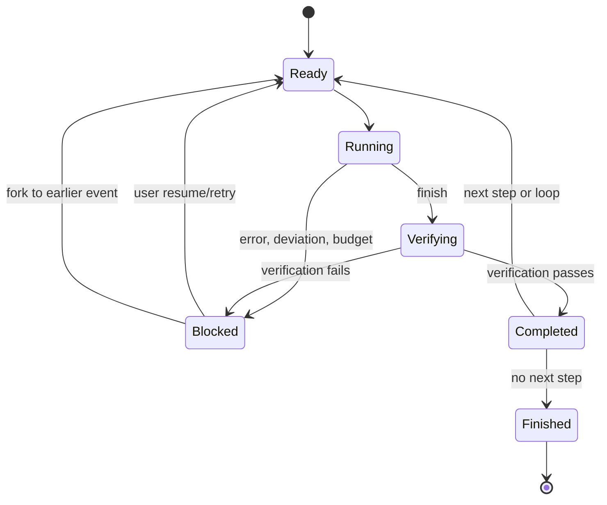

# Execution contract — v0.1

## Philosophy

The harness MUST stop when a step reports an unapproved blocker, prohibited scope change, or failed verification. Its objective is not unconditional task completion; a justified stop is a valid outcome. The model may report evidence, make proposals, and request tools; only the harness selects transitions and controls tool execution.

## Definitions

- **Workflow:** a graph of step definitions under one folder.
- **Session:** goal + active execution branch + workflow ID.
- **Step:** YAML-frontmatter Markdown definition, reloaded when executed.
- **Run:** execution of one step on one branch; a loop creates additional runs.
- **Attempt:** retry of a step; v0.1 records events and a new step run rather than assigning a distinct attempt table ID.
- **Artifact:** named, versioned UTF-8 content stored in session state, not necessarily a filesystem file.
- **Deviation:** an agent-reported or engine-detected condition that selects a preauthorized action. Unknown deviations always stop.

## State rules

1. Steps start with fresh provider conversation state and selected artifacts.
2. Required inputs MUST exist in the visible session branch, otherwise the run stops.
3. LLM responses must be a single YAML action: tool, artifact, finish, or deviation.
4. A tool action is subject to step capabilities and an independent permission check. Denied tools do not execute.
5. A finish action is accepted only after all required output artifacts were generated during the **current** run and verification passed.
6. A failed verification blocks by default. No unapproved fallback to another tool/model/architecture.
7. A configured deviation may `pause`, `goto`, or bounded `retry`; unknown deviations pause.
8. Tool invocation, result, model output, verification outcome, session and branch events are append-only.
9. A new branch inherits records through its fork event; later events on the previous branch remain available through the original branch, but not visible on the new one.
10. The **branch pointer alone** does not rewind the filesystem. The CLI `fork` and TUI restart can preview and apply a **separate guarded restore of journaled native edits** before branching; `fork --no-restore` explicitly skips it. Neither path promises rollback of manual changes, shell cache effects, or external services.
11. Prompt changes take effect on subsequent step runs; each run records a resolved definition in the event log.
12. Hard session safety limit: 100 step runs per `start` or `resume` command.
13. A CLI/TUI run must hold the session's OS execution lock before publishing instructions or changing execution state. An interrupted owner requires explicit recovery; unanswered approvals expire and are never replayed. Read-only observers remain permitted. Recovery does not resume work or turn a completed session back into runnable work.

## State diagram



## Agent protocol

The **authoritative field-by-field reference** for coding-agent YAML responses is [Agent action protocol](13-agent-action-protocol.md), grounded in the implemented `AgentAction` parser, tool handlers and engine dispatch. Examples below are illustrative and should not be treated as an additional schema.

Actions are single YAML mappings. Content fields may contain multiline Markdown.

```yaml
# Register a produced document
action: artifact
name: investigation.md
content: |
  Reproduction: ...
```

```yaml
# Request a tool (the harness enforces capability and permission)
action: tool
tool: shell
input: uv run basedpyright
```

```yaml
# Stop rather than compensate for an architectural problem
action: deviation
deviation_id: architectural_blocker
summary: |
  The approved plan cannot be implemented without ...
  Evidence: ...
  Options: ...
```

```yaml
action: finish
summary: Implementation matches the plan; see implementation-report.md
```

## Verification

Verification is **mandatory in the resolved configuration**, even when it is `type: none`. v0.1 supports `none`, `human`, `command`, `agent`, `all` and `any`. Composite `all` supports nesting via a stack; `any` can directly contain only leaf checks. A failed check is logged. The agent reviewer uses a fresh provider call; it cannot gain tools and it reviews textual evidence, not an authenticated independent filesystem snapshot.

## Deviation detection

A model may report a configured deviation. If the rule has a detector prompt, one shared evaluator makes exactly one detector request for that report and records the raw response as `deviation.detector`. A valid verdict is recorded once as `deviation.accepted` or `deviation.rejected`. Accepted agent reports retain their validated status through the outer handler, which applies the configured pause/goto/retry without another detector call. Rejected agent reports return the reason to the **same conversation** and do not route or consume a configured retry. A later report is a new report and may be evaluated again.

Malformed detector responses, request failures and unreadable detector prompts block the step. Engine-generated failures such as missing outputs or failed verification still evaluate a matching configured detector once, when present; rejection blocks rather than inventing an agent conversation to resume. Unknown IDs block, and rules without detector prompts route without a detector request. No detector monitors an in-flight model response.

## Acceptance scenarios

- Fix-bug workflow: failed reproduction or unknown root cause => blocked without any hidden patch; valid fix => verification; failed CI => blocked.
- Feature workflow: plan => human approval => implement; unapproved scope increase => blocked.
- Optimization workflow: baseline => optimize => benchmark => evaluate; target unmet => loop; regression => blocked; redesign required => blocked.

## Known deviations from the full design

No transactional tool side effects, no automatic Git restoration, no stable step attempt IDs, no streaming model output, no automatic compaction, no independent review of command outputs, and no graph-branch visualizer. These are deliberate scope boundaries, not guarantees.
