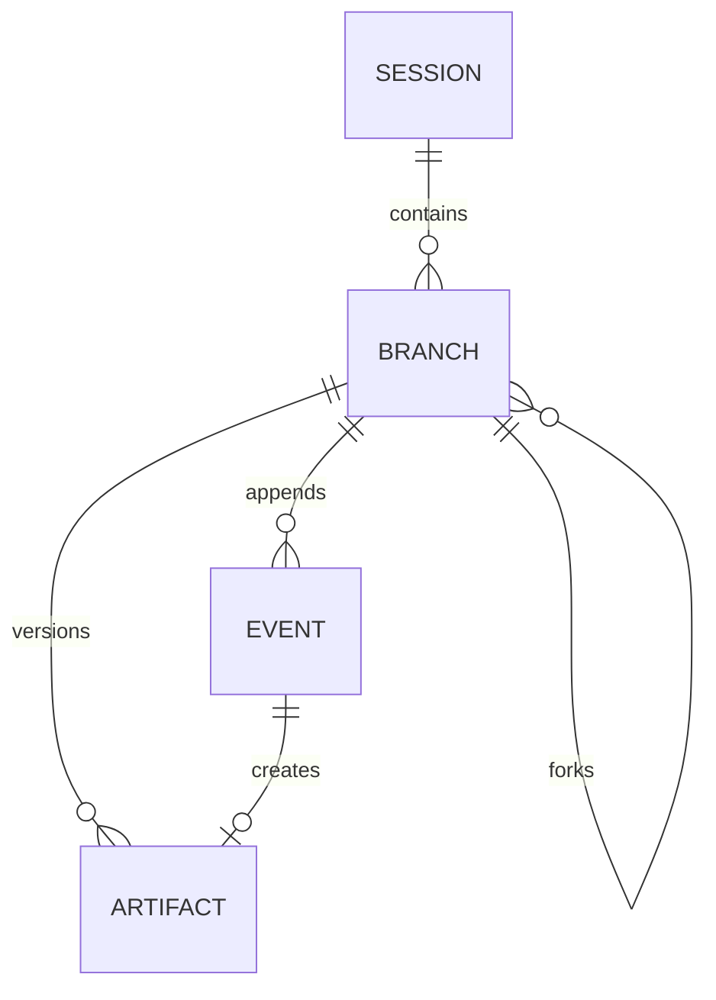

# Persistence and branching — v0.1

SQLite and an append-only event stream underpin sessions and registered artifacts. Tables:

- `sessions`: ID, workflow, goal, active branch, current step, status.
- `branches`: ID, session, parent branch, fork event ID.
- `events`: global increasing ID, session, branch, step, event kind, YAML/text payload, timestamp.
- `artifacts`: version reference, producing step, branch, creation event, immutable blob path.

History reconstruction traverses parent pointers, including events in each ancestor only up to the fork cutoff. Two branches may share the same earlier events and have independent later events. The active branch is a mutable pointer; `branches` lists branch ancestry and `switch --branch ID --step STEP` selects another branch without deleting anything. Event history never needs to be rewritten or deleted.

`stepwright fork ID --event N --step plan` creates another branch with an ancestor cutoff at event N. The selected event must belong to the current branch's visible history. The command intentionally leaves project files untouched, since arbitrary shell commands cannot be reversed safely. Before resuming an earlier implementation step, manually restore a matching code checkpoint if needed.

A registered artifact is an immutable snapshot in `.stepwright/state/blobs`. `put-artifact` creates another version and records the user edit. Source revisions in project files are separate and not automatically captured by the artifact store.

`step.definition` records the resolved step structure for each run. Model and tool observations are recorded as raw text where feasible; service credentials are intentionally never serialized. Avoid placing secrets in prompts or tool output because model replies and command results are persisted. SQLite is stored locally in the project by default, and may contain sensitive code/notes.

Future changes: per-run and per-attempt stable IDs, transactionally consistent side-effect checkpoints, branch selection/compare, garbage collection, and replay of external service calls.
