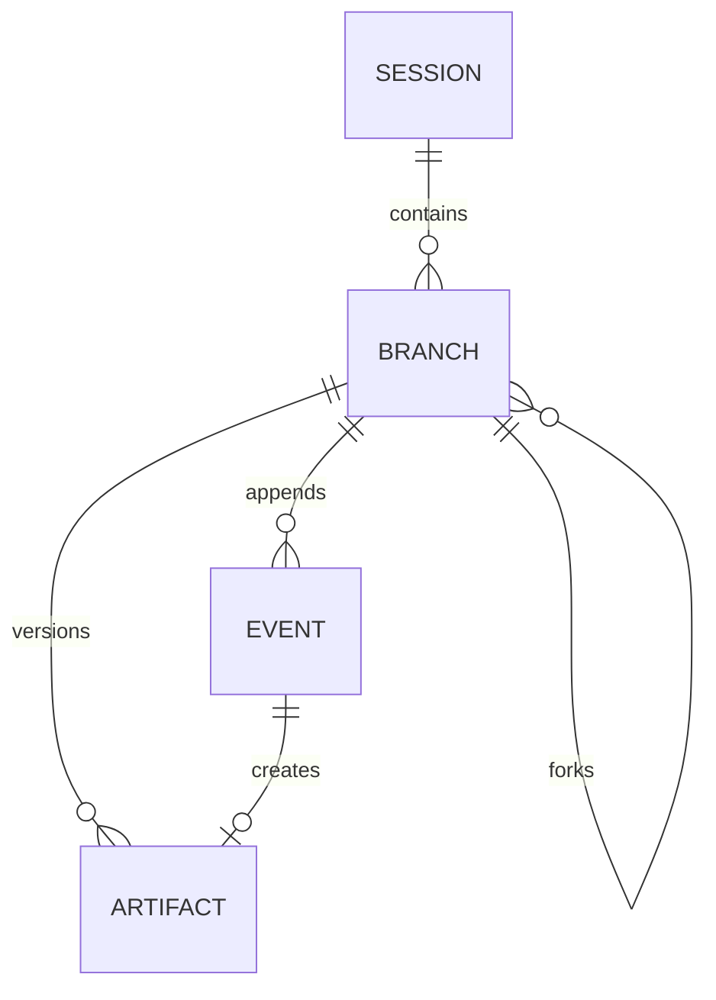

# Persistence and branching — v0.1

SQLite and an append-only event stream underpin sessions and registered artifacts. Tables:

- `sessions`: ID, workflow, goal, active branch, current step, status.
- `branches`: ID, session, parent branch, fork event ID.
- `events`: global increasing ID, session, branch, step, event kind, YAML/text payload, timestamp.
- `artifacts`: version reference, producing step, branch, creation event, immutable blob path.

History reconstruction traverses parent pointers, including events in each ancestor only up to the fork cutoff. Two branches may share the same earlier events and have independent later events. The active branch is a mutable pointer; `branches` lists branch ancestry and `switch --branch ID --step STEP` selects another branch without deleting anything. Event history never needs to be rewritten or deleted.

`greenlight fork ID --event N --step plan` creates another branch with an ancestor cutoff at event N. The event must be in the active branch's visible history. By default, the CLI **previews and offers a guarded native-edit workspace restore before forking**; declining it creates the branch without changing project files. `--no-restore` skips even the workspace inspection. The TUI `/restart` similarly previews journal-backed restoration before forking. Neither operation reconstructs arbitrary manual/external edits, sandbox cache changes or Git state. See [workspace restoration](09-workspace-restore.md).

A registered artifact is an immutable snapshot in `.greenlight/state/blobs`. `put-artifact` creates another version and records the user edit. Source revisions in project files are separate and not automatically captured by the artifact store.

Artifact publication syncs a uniquely named blob and its directory before committing the artifact row and `artifact.created` event together in SQLite. A failed publication rolls back both database records and attempts to remove the unpublished blob, reporting cleanup failures explicitly. A process crash before commit may leave an unreferenced blob; it does not publish a success event. This does not repair inconsistencies already present in older histories.

Native writes persist original/intended contents in SQLite `write_intents` before replacing source files. Completion atomically publishes the journal records and marks the intent completed. Explicit `recover-writes` reconciliation distinguishes applied, unapplied and conflicting interrupted writes without changing source files. See [native edit recovery](07-edit-history.md). SQLite uses `synchronous=FULL` with WAL mode.

Each CLI/TUI execution holds a per-session OS file lock for its entire run and records a unique owner token in `execution_owners`. Instructions, running state and owner publication commit together after locking. PID metadata is diagnostic only; neither PID reuse nor elapsed time determines ownership. Normal completion/error clears the owner record while still holding the lock. A crash or panic releases the OS lock but leaves a record that requires explicit `recover-session SESSION_ID` (TUI `/recover`). Recovery refuses a live owner, preserves completed sessions, and otherwise marks interrupted sessions blocked without resuming them. Legacy `running` flags without owner records can also be recovered.

Unanswered approvals are private worker channels, never replayed after recovery. Saved grants are unchanged. Inspection remains available while another process runs; branch changes and restore application refuse a live or unrecovered owner. Lock files are retained, never removed to force takeover. Ownership is per session, not a whole-project lease: different sessions can still execute concurrently. Interrupted native writes require session recovery first, then `recover-writes`, then an explicit resume.

`step.definition` records the resolved step structure for each run. Model and tool observations are recorded as raw text where feasible; service credentials are intentionally never serialized. Avoid placing secrets in prompts or tool output because model replies and command results are persisted. SQLite is stored locally in the project by default, and may contain sensitive code/notes.

Future changes: durable attempt IDs, crash-consistent explicit restoration and broader recovery, branch comparison, garbage collection (including unreferenced blobs), and explicit handling of external side effects (not automatic replay of irreversible calls). Step-boundary workspace hashes exist today but do not capture old file bytes; see [workspace recording](14-workspace-recording.md).
