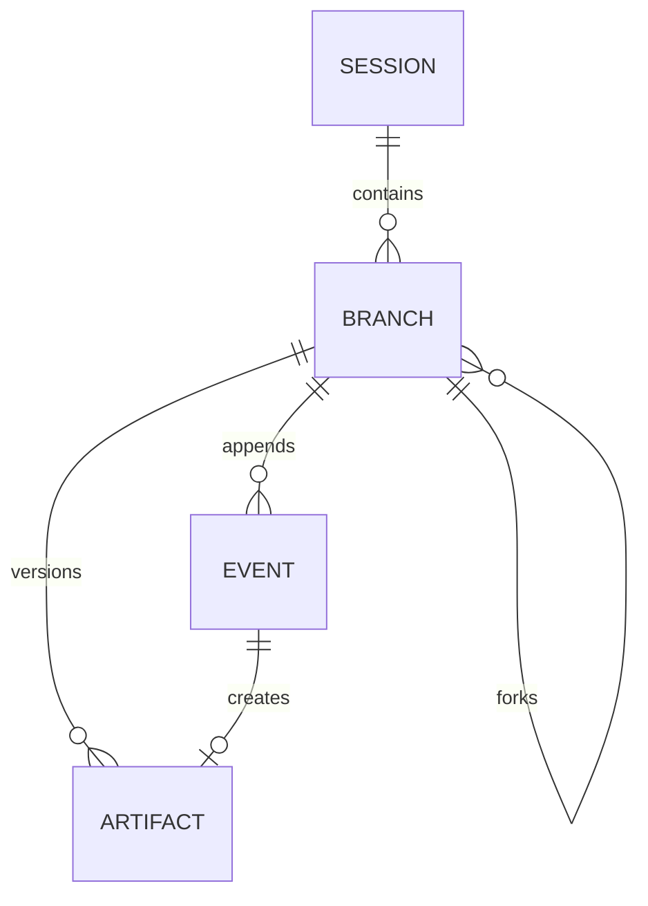

# Persistence and branching — v0.1

SQLite and an append-only event stream underpin sessions and registered artifacts. Tables:

- `sessions`: ID, workflow, goal, active branch, current step, status.
- `branches`: ID, session, parent branch, fork event ID.
- `events`: global increasing ID, session, branch, step, event kind, YAML/text payload, timestamp.
- `artifacts`: version reference, producing step, branch, creation event, immutable blob path.

History reconstruction traverses parent pointers, including events in each ancestor only up to the fork cutoff. Two branches may share the same earlier events and have independent later events. The active branch is a mutable pointer; `branches` lists branch ancestry and `switch --branch ID --step STEP` selects another branch without deleting anything. Event history never needs to be rewritten or deleted.

`greenlight fork ID --event N --step plan` creates another branch with an ancestor cutoff at event N. The event must be in the active branch's visible history. By default, the CLI **previews and offers a guarded native-edit workspace restore before forking**; declining it creates the branch without changing project files. `--no-restore` skips even the workspace inspection. The TUI `/restart` similarly previews journal-backed restoration before forking. Neither operation reconstructs arbitrary manual/external edits, sandbox cache changes or Git state. See [workspace restoration](09-workspace-restore.md).

A registered artifact is an immutable snapshot in `.greenlight/state/blobs`. `put-artifact` creates another version and records the user edit. Source revisions in project files are separate and not automatically captured by the artifact store.

Artifact publication syncs a uniquely named blob and its directory before committing the artifact row and `artifact.created` event together in SQLite. A failed publication rolls back both database records and attempts to remove the unpublished blob, reporting cleanup failures explicitly. A process crash before commit may leave an unreferenced blob; it does not publish a success event. This does not repair inconsistencies already present in older histories.

Native writes persist original/intended contents in SQLite `write_intents` before replacing source files. Completion atomically publishes the journal records and marks the intent completed. Explicit `recover-writes` reconciliation distinguishes applied, unapplied and conflicting interrupted writes without changing source files. See [native edit recovery](07-edit-history.md). SQLite uses `synchronous=FULL` with WAL mode.

Each CLI/TUI execution holds a per-session OS file lock for its entire run and records a unique owner token in `execution_owners`. Instructions, running state and owner publication commit together after locking. PID metadata is diagnostic only; neither PID reuse nor elapsed time determines ownership. Normal completion/error clears the owner record while still holding the lock. A crash or panic releases the OS lock but leaves a record that requires explicit `recover-session SESSION_ID` (TUI `/recover`). Recovery refuses a live owner, preserves completed sessions, and otherwise marks interrupted sessions blocked without resuming them. Legacy `running` flags without owner records can also be recovered.

Unanswered approvals are private worker channels, never replayed after recovery. Saved grants are unchanged. Inspection remains available while another process runs; branch changes and restore application refuse a live or unrecovered owner. Lock files are retained, never removed to force takeover. Ownership is per session, not a whole-project lease: different sessions can still execute concurrently. Interrupted native writes require session recovery first, then `recover-writes`, then an explicit resume.

`step.definition` records the resolved step structure for each run. Model and tool observations are recorded as raw text where feasible; service credentials are intentionally never serialized. Avoid placing secrets in prompts or tool output because model replies and command results are persisted. SQLite is stored locally in the project by default, and may contain sensitive code/notes.

New step executions create a durable UUID in `step_attempts`, linking the resolved definition and start event in one transaction. Completion, deviation, blockage and runner recovery record the outcome/end event. `greenlight attempts SESSION_ID` lists attempts visible through the active branch's ancestry cutoff; a fork inside a parent attempt reports it as inherited-partial rather than importing its later outcome. Existing event history is retained without backfilling guessed IDs.

Agent verification uses only artifacts produced during the active attempt and its latest ten recorded tool results/errors or command-verification observations. Full recorded bodies are included, subject to the configured byte limit; oversized evidence blocks rather than silently truncating it. `verification.evidence` records the attempt UUID and exact artifact/observation event IDs used. Artifact versions are identified by creation event ID.

Every new attempt saves `context.inputs`: its UUID, exact selected artifact versions and applicable approval event references. Human approval stores the displayed manifest event and versions in `human.approved`, after transactionally checking that input selection has not changed. Downstream consumption requires a completed gate's exact approved versions; changes require explicit reapproval. Reads and checks follow active-branch ancestry. Older unversioned approvals are not silently upgraded or assumed to cover newer artifacts. The default TUI artifact list shows latest versions with an explicit creation-ID version browser; the input manifest remains the audit authority for what was actually used.

Every completion dispatch is registered in `model_calls` before sending, with a UUID, event reference, attempt/purpose/provider/model, estimated initial input and a price snapshot. The same row is updated with reported or estimated usage; missing cache/output/billing stays unknown. Session spending includes requests on all branches exactly once; branch and ancestry-visible reports are separate views. Older runs are not backfilled. See [usage accounting](18-token-usage-and-pricing.md).

Future changes: crash-consistent explicit restoration and broader recovery, branch comparison, garbage collection (including unreferenced blobs), and explicit handling of external side effects (not automatic replay of irreversible calls). Step-boundary workspace hashes exist today but do not capture old file bytes; see [workspace recording](14-workspace-recording.md).

## Tool outcome correlation

New agent-tool and command-step requests record `tool.request` as serialized request arguments. After execution returns, one SQLite transaction publishes the existing `tool.result` or `tool.error` event and a `tool.finished` JSON record containing `request_event`, `outcome_event`, `tool` and optional `exit_code`. The request event ID is the call identity; the outcome remains the timeline/evidence anchor. `exit_code` is populated only for recorded shell results with the harness's exit-code prefix, never inferred from read/web contents. Command steps synthesize a shell request from their saved command; the record does not claim that a model authored it.

Atomic publication prevents an output/correlation pair from becoming partially visible. It does not make tool execution and event persistence atomic: a tool can run before persistence fails. Existing native-write intent/journal recovery continues to govern uncertain edits; a missing output is not evidence that execution never happened.

The card projection validates referenced events against current branch-visible history, step, order, request tool and exit code, and rejects references crossing attempt/fork boundaries or duplicate outcomes. Malformed correlation stays visible as raw diagnostic evidence. Historical output events without explicit correlation remain unlinked; no IDs are guessed or backfilled. UI inspection adds no execution/approval events.

New model requests also record exact prepared message references in `model.request` and visible returned content in `model.response`. Immutable content-addressed message blobs avoid duplicating shared request prefixes. [Conversation dumps](35-conversation-dump.md) export this evidence with branch cutoffs and label missing legacy payloads; they never reconstruct private reasoning or execution outcomes.

## Session and branch publication

Session creation publishes its session, initial branch and start event in one SQLite transaction. Forking and branch selection likewise publish the branch/session update and audit event together. The caller’s in-memory session changes only after commit succeeds. Statement or commit failure leaves the previous history and selection intact, so a caller can safely inspect or retry publication. This does not create a workspace-wide execution lock or a transaction around external tool effects.
