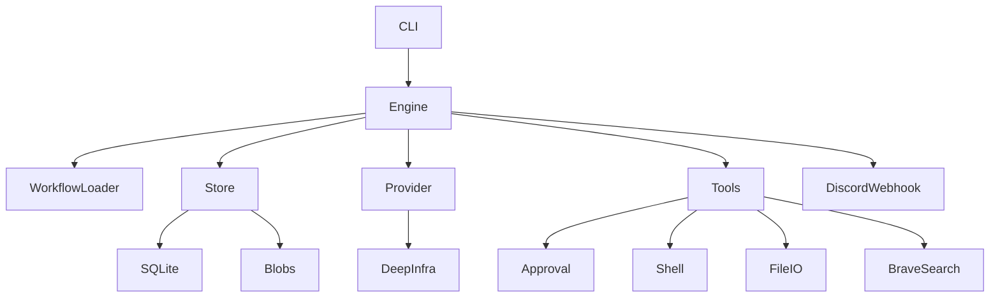

# Architecture and security — v0.1

## Current modules

- `config.rs` — strict serde YAML structs, workflow/step parse and validation, restricted prompt includes.
- `engine.rs` — sequential execution, per-step fresh context, YAML action dispatch, verification and deviation routing.
- `store.rs` — SQLite session/event/branch history, immutable registered artifacts.
- `provider.rs` — HTTP chat-completions and model discovery through the DeepInfra OpenAI-compatible API.
- `tools.rs` — approval before host shell/read/write/web operations and safety limits.
- `main.rs` — Clap terminal commands.

## Trust boundaries

- No sandbox. `sh -c` runs on the host with the developer's normal PATH, Python/uv installation, and environment, with a 120s timeout.
- Tool restrictions are enforced by Rust before dispatch, but arbitrary approved commands can access anything the user's OS account can. A malicious prompt or workflow file is dangerous. This is not isolation.
- File read/write requests are constrained to an existing project-relative path with canonicalization; shell commands are not similarly isolated. TOCTOU symlink races may exist.
- API keys come from environment variables; they are not included in serialized config or logs by the harness.
- Search uses the Brave Web Search API if `BRAVE_SEARCH_API_KEY` is set. Web responses are untrusted content and can be prompt-injection sources.
- The provider sends workflow prompts, step artifacts and tool observations to the configured DeepInfra endpoint. Do not run on confidential projects unless you accept that transfer.
- Discord webhook notifications are outbound-only; failures are printed to stderr. The webhook URL is read from an environment variable.

## Architecture decision records

### ADR-001: Modular monolith

Choose a single Rust binary with modules instead of a distributed service. Reason: low operational complexity, clear process ownership, easy local CLI use. Revisit when adding remote workers.

### ADR-002: Host execution in v0.1

Choose host execution to match developer environment, paired with visible approvals. Deferred sandboxing must later introduce a genuine process-isolation boundary; adding a trait alone does not make host execution safe.

### ADR-003: YAML agent protocol, JSON HTTP transport

Choose YAML for model-to-runtime actions and workflow authoring; use JSON only for the required wire format of DeepInfra's OpenAI-compatible REST endpoint. Use strict schema checks and keep raw model responses in logs.

### ADR-004: Branchable append-only session log

Choose events + parent/cutoff branches with immutable artifact versions. Rewinding the conversation does not rewind filesystem side effects.
