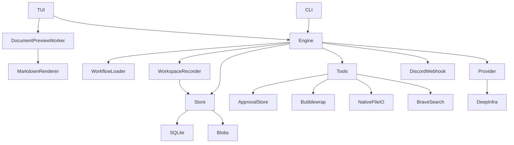

# Architecture and security — v0.1

## Current modules

- `config.rs` — strict serde YAML structs, workflow/step parse and validation, restricted prompt includes.
- `engine.rs` — sequential execution, per-step fresh context, YAML action dispatch, verification and deviation routing.
- `store.rs` — SQLite session/event/branch history, registered immutable artifacts and native-edit journals.
- `write_journal.rs` — durable native-write intents, atomic replacement, mutation locking and explicit interrupted-write reconciliation.
- `locks.rs` — advisory lock guards explicitly unlock on drop, preventing copied descriptors from retaining finished operations during concurrent process spawning.
- `session_execution.rs` — per-session OS execution locks, persisted owner records, guarded cleanup and explicit stale-owner recovery.
- `workspace.rs` — bounded before/after step manifests and read-only SHA-256 drift inspection; hashes are not snapshots.
- `restore.rs` — guarded historical reconstruction of journaled native edits and individual-file restore.
- `sandbox.rs` — mandatory Linux Bubblewrap isolation for shell commands, with read-only project mount and isolated writable cache.
- `approvals.rs` — saved project/global grants, separate from temporary process-level decisions.
- `usage.rs` — request usage ledger, token-count provenance, tiktoken fallback, immutable pricing snapshots and scoped cost summaries.
- `provider.rs` — HTTP chat-completions and model discovery through the DeepInfra OpenAI-compatible API.
- `tools.rs`, `file_discovery.rs` — project-root-confined native file reads, bounded directory discovery, journaled writes and sandboxed shell/web dispatch.
- `action_envelope.rs`, `agent_protocol.rs` — unambiguous action envelopes, field validation help and the embedded coding prompt.
- `conversation_dump.rs` — durable exact-message traces and read-only branch-scoped Markdown/JSON exports.
- `tui.rs` — foreground application state, store refresh, worker lifecycle and the terminal loop.
- `tui/focus.rs`, `tui/reading.rs`, `tui/routing.rs` — focus/draft state, session/branch reading positions, cached-row activity filtering and modal keyboard precedence.
- `tui/exports.rs` — explicit clipboard exports and private editor-review snapshots, with terminal handoff/restoration. Helpers receive selected text, never a mutable Store/Engine handle.
- `activity_cards.rs` — atomic tool outcome/correlation publication and pure branch-visible semantic card projections.
- `activity_titles.rs` — strict optional coding-action title validation and response-linked annotation schema. Intent cards never establish execution outcomes or grant permissions.
- `pricing.rs` — bounded public DeepInfra pricing discovery, exact-provider matching, private local caching and explicit-override precedence. `usage.rs` snapshots resolved prices, freshness, context tiers and cache-creation estimates per request.
- `manager.rs`, `tui/manager_ui.rs` — bounded source snapshots, strict manager decision validation, private exchanges and independent read-only TUI inference. Uses central usage with purpose `manager`; no manager branch/step/tool execution path exists yet.
- `workspace.rs`, `workspace_audit.rs` — bounded step-boundary SHA-256 scans and metrics, plus interval-scoped branch-visible write/restore hash-chain correlation. Reports distinguish journal agreement, unexplained drift and unavailable coverage; they never restore files or identify an editor.
- `tui/activity.rs`, `tui/view.rs`, `tui/help.rs` — card/audit presentation, evidence expansion, workspace layout and discoverable keys.
- `tui/approval.rs`, `tui/recovery.rs` — explicit approval choices and guarded restart/restore interactions.
- `tui/reader.rs`, `markdown.rs` — bounded background preparation of large document viewports and terminal-safe Markdown/literal presentation.
- `tui_actions.rs` — Engine workers and typed restart candidates; document rendering never invokes this execution path.
- `session_picker.rs`, `workspace_view.rs`, `artifact_history.rs` — session discovery/creation, recorded attempt projections and branch-visible artifact history/provenance.
- `paths.rs` — canonical `.greenlight/state` location and guarded migration of legacy `.stepwright/state`.
- `main.rs` — Clap CLI and TUI entry points. Both paths use the same engine, store and permission rules.

## Document preview worker

Documents over 8 KiB or 64 lines use a lazily started per-TUI preview thread. The foreground supplies a bounded UTF-8 prefix, presentation mode, immutable document identity, headers and viewport dimensions/scroll. The worker caches parsed text and wrapped line counts, then produces only the viewport's terminal buffer. The foreground copies visible cells, not a full parsed document, on redraw. Short previews keep the bounded synchronous path.

Request and response queues each have capacity one. Results are accepted only for the current document revision, mode, dimensions and requested scroll; obsolete work may finish but cannot replace the selected document or an approval. A discarded completed viewport can be requested again after resizing back. Closing the application drops the channels; the worker receives only text/presentation data, does not retain engine/store handles or approval state, and performs no credential reads or file I/O. It is a same-process CPU worker, not a sandbox. A failed worker reports an unavailable preview and leaves navigation usable.

This separates document CPU work, not every blocking operation: store refresh/blob reads, explicit artifact-diff construction and approval-request rendering still use their existing foreground paths. Artifact/diff limits and permission checks are unchanged; broad asynchronous storage/execution is not introduced by this refactor.

## Trust boundaries

- **Shell isolation is mandatory:** agent shell actions, `command` steps and command verification use Bubblewrap (Linux only; no unsandboxed fallback). The project is read-only at `/workspace`; the shell has a cleared environment, no network, a private home and an isolated writable `/tmp` and `/cache`. Bubblewrap availability and user namespaces must be verified on the host.
- Shell isolation is not a complete security boundary against malicious code: selected host binaries/toolchains remain visible; unknown secrets inside source files, resource exhaustion and kernel vulnerabilities remain risks. Native `write` changes project files only after path checks and the applicable approval policy.
- Rust restricts native file paths, but symlink/concurrent-change races and partial filesystem failures are still relevant. Native writes persist original/intended contents before replacement and reconcile interruptions explicitly without rewriting source files. Restores refuse tracked-file drift and disallowed paths but retain an apply-before-journal crash window and are **not** atomic across files.
- Project and global permission grants are saved explicitly. Their scope is not changed by a model response; a configured `deny` overrides saved grants. Pending TUI approval requests are in-process and expire when their worker disconnects. Per-session OS locks prevent competing CLI/TUI execution, with persisted owner records requiring explicit recovery after worker loss. Different sessions do not share an execution lease for the whole workspace.
- API keys come from environment variables; they are not included in serialized config or logs by the harness.
- Search uses the Brave Web Search API if `BRAVE_SEARCH_API_KEY` is set. Web responses are untrusted content and can be prompt-injection sources.
- The provider sends workflow prompts, step artifacts and tool observations to the configured OpenAI-compatible endpoint (DeepInfra by default). Do not run on confidential projects unless you accept that transfer.
- Discord webhook notifications are outbound-only; failures are printed to stderr. The webhook URL is read from an environment variable.

## Architecture decision records

### ADR-001: Modular monolith

Choose a single Rust binary with modules instead of a distributed service. Reason: low operational complexity, clear process ownership, easy local CLI use. Revisit when adding remote workers.

### ADR-002: Shell execution boundary (updated after original v0.1 design)

**Superseded:** the original v0.1 implementation ran shell commands directly on the host. Current Greenlight requires **Bubblewrap**, a read-only project mount and no network for all harness-initiated shell execution. Native writes are a distinct permissioned tool with their own before/after edit journal. The rationale and limits are in [Linux shell sandbox](10-shell-sandbox.md). This design deliberately prevents shell commands from modifying project source or installing dependencies into it.

### ADR-003: YAML agent protocol, JSON HTTP transport

Choose YAML for model-to-runtime actions and workflow authoring; use JSON only for the required wire format of DeepInfra's OpenAI-compatible REST endpoint. Use required-field/schema checks, reject ambiguous envelopes and keep raw model responses in logs. One unambiguous fenced mapping may have surrounding commentary; only its mapping is dispatched.

### ADR-004: Branchable append-only session log

Choose events + parent/cutoff branches with immutable artifact versions. Branch ancestry alone never rewinds files; CLI `fork` and TUI restart now offer an **explicit guarded restore** of journaled native edits, not a general Git/external-state rewind. See [workspace restoration](09-workspace-restore.md).

### ADR-005: Workspace recording before expanded rollback

Keep the native-write journal as the recovery basis. Record bounded SHA-256 manifests at step boundaries to detect drift without storing arbitrary project-file bodies; compare observed differences against the journal before considering broader snapshots. See [workspace recording](14-workspace-recording.md).

### ADR-006: Model suggestions are not authority

Optional activity titles and future summaries/manager/coordinator proposals are untrusted annotations or suggestions. The Rust engine validates tool policies, workflow transitions, verification and restoration; an additional model must not bypass those controls. See [settled decisions](16-decision-log.md) and [current TUI behavior](11-tui.md).

The [coordinator contract](20-conversational-coordinator.md) now has a [read-only Q&A implementation](21-manager-qa.md) using its bounded evidence/JSON interface and [compiled system prompt](prompts/manager-v1.md). Original-message records are separate from executing instructions. Manager calls can observe a live owner but cannot act on a route, acquire execution ownership, grant approval or modify coding context. Targeted delivery and the durable live inbox remain future work.

Project setup and root discovery live in `src/project.rs`; embedded resources are listed in `src/project_templates.rs`. `src/paths.rs` selects canonical/legacy config and workflow paths and protects private settings/state. The standalone `install.sh` maintains its source/build cache outside projects; see [installation and projects](22-installation-and-projects.md).

`src/agent_protocol.rs` compiles the [coding-agent system prompt](prompts/coding-agent-v1.md), provides scoped tool examples and constructs protocol-format repair messages. The parser still rejects tool-named actions; syntax guidance never dispatches or authorizes an operation.

## Patterns used to keep the implementation local

- **Typed commands and shared metadata:** `tui/actions.rs` owns action identities and the shortcut/label registry used by workspace keyboard routing, buttons and the Help reference. `tui/shell.rs` dispatches those actions directly; it does not convert commands into artificial keypresses. Context-specific navigation and literal text editing remain explicit in `tui/routing.rs`.
- **Decision input ownership:** the derived `DecisionLayer` identifies Help, tool/provider permissions, human choices, human evidence, revert confirmation or ordinary workspace input. Both keyboard routing and direct actions respect the top layer. Esc hides tool/provider popups without deciding; human evidence cannot approve; Help cannot forward a decision underneath itself. This projects existing state rather than adding another persisted state machine.
- **Units of work:** session creation and branch publication wrap their related rows and audit event in a single transaction. Branch operations prepare a local next session and expose it to the caller only after commit.
- **Serialized read–modify–write:** approval grants hold an OS lock on a stable sibling file while reloading, merging and atomically publishing one scope. Locks are advisory and do not govern external editors.
- **Shared policy boundaries:** project paths and exact file snapshots retain shared guards, while read/write/restore differences remain explicit.

Keep orchestration flat. Extract shared rules or substantial operations, not single-expression forwarding functions. Durable continuations and a broader execution state machine remain separate designs; these changes do not replay failed tools or change workflow transitions.
