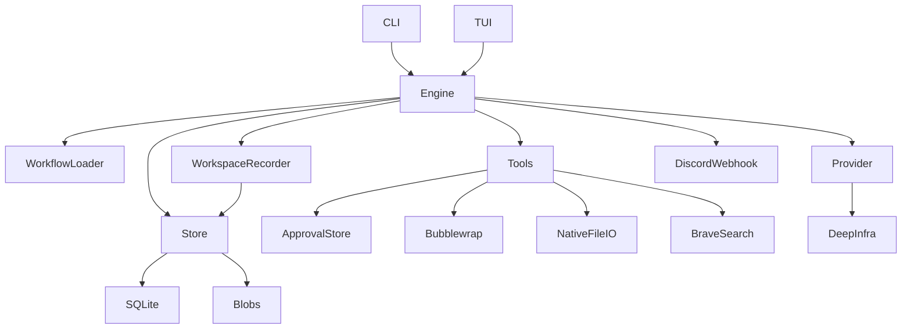

# Architecture and security — v0.1

## Current modules

- `config.rs` — strict serde YAML structs, workflow/step parse and validation, restricted prompt includes.
- `engine.rs` — sequential execution, per-step fresh context, YAML action dispatch, verification and deviation routing.
- `store.rs` — SQLite session/event/branch history, registered immutable artifacts and native-edit journals.
- `write_journal.rs` — durable native-write intents, atomic replacement, mutation locking and explicit interrupted-write reconciliation.
- `session_execution.rs` — per-session OS execution locks, persisted owner records, guarded cleanup and explicit stale-owner recovery.
- `workspace.rs` — bounded before/after step manifests and read-only SHA-256 drift inspection; hashes are not snapshots.
- `restore.rs` — guarded historical reconstruction of journaled native edits and individual-file restore.
- `sandbox.rs` — mandatory Linux Bubblewrap isolation for shell commands, with read-only project mount and isolated writable cache.
- `approvals.rs` — saved project/global grants, separate from temporary process-level decisions.
- `provider.rs` — HTTP chat-completions and model discovery through the DeepInfra OpenAI-compatible API.
- `tools.rs` — permissioned native file access and sandboxed shell/web dispatch.
- `tui.rs`, `tui_actions.rs`, `markdown.rs` — Ratatui session views, approval/restart interactions, and a small safe-text Markdown presentation layer.
- `paths.rs` — canonical `.greenlight/state` location and guarded migration of legacy `.stepwright/state`.
- `main.rs` — Clap CLI and TUI entry points. Both paths use the same engine, store and permission rules.

## Trust boundaries

- **Shell isolation is mandatory:** agent shell actions, `command` steps and command verification use Bubblewrap (Linux only; no unsandboxed fallback). The project is read-only at `/workspace`; the shell has a cleared environment, no network, a private home and an isolated writable `/tmp` and `/cache`. Bubblewrap availability and user namespaces must be verified on the host.
- Shell isolation is not a complete security boundary against malicious code: selected host binaries/toolchains remain visible; unknown secrets inside source files, resource exhaustion and kernel vulnerabilities remain risks. Native `write` changes project files only after path checks and the applicable approval policy.
- Rust restricts native file paths, but symlink/concurrent-change races and partial filesystem failures are still relevant. Native writes persist original/intended contents before replacement and reconcile interruptions explicitly without rewriting source files. Restores refuse tracked-file drift and disallowed paths but retain an apply-before-journal crash window and are **not** atomic across files.
- Project and global permission grants are saved explicitly. Their scope is not changed by a model response; a configured `deny` overrides saved grants. Pending TUI approval requests are in-process and expire when their worker disconnects. Per-session OS locks prevent competing CLI/TUI execution, with persisted owner records requiring explicit recovery after worker loss. Different sessions do not share an execution lease for the whole workspace.
- API keys come from environment variables; they are not included in serialized config or logs by the harness.
- Search uses the Brave Web Search API if `BRAVE_SEARCH_API_KEY` is set. Web responses are untrusted content and can be prompt-injection sources.
- The provider sends workflow prompts, step artifacts and tool observations to the configured DeepInfra endpoint. Do not run on confidential projects unless you accept that transfer.
- Discord webhook notifications are outbound-only; failures are printed to stderr. The webhook URL is read from an environment variable.

## Architecture decision records

### ADR-001: Modular monolith

Choose a single Rust binary with modules instead of a distributed service. Reason: low operational complexity, clear process ownership, easy local CLI use. Revisit when adding remote workers.

### ADR-002: Shell execution boundary (updated after original v0.1 design)

**Superseded:** the original v0.1 implementation ran shell commands directly on the host. Current Greenlight requires **Bubblewrap**, a read-only project mount and no network for all harness-initiated shell execution. Native writes are a distinct permissioned tool with their own before/after edit journal. The rationale and limits are in [Linux shell sandbox](10-shell-sandbox.md). This design deliberately prevents shell commands from modifying project source or installing dependencies into it.

### ADR-003: YAML agent protocol, JSON HTTP transport

Choose YAML for model-to-runtime actions and workflow authoring; use JSON only for the required wire format of DeepInfra's OpenAI-compatible REST endpoint. Use strict schema checks and keep raw model responses in logs.

### ADR-004: Branchable append-only session log

Choose events + parent/cutoff branches with immutable artifact versions. Branch ancestry alone never rewinds files; CLI `fork` and TUI restart now offer an **explicit guarded restore** of journaled native edits, not a general Git/external-state rewind. See [workspace restoration](09-workspace-restore.md).

### ADR-005: Workspace recording before expanded rollback

Keep the native-write journal as the recovery basis. Record bounded SHA-256 manifests at step boundaries to detect drift without storing arbitrary project-file bodies; compare observed differences against the journal before considering broader snapshots. See [workspace recording](14-workspace-recording.md).

### ADR-006: Model suggestions are not authority

Future activity titles, summaries and manager/coordinator proposals are untrusted annotations or suggestions. The Rust engine validates tool policies, workflow transitions, verification and restoration; an additional model must not bypass those controls. See [decision log](16-decision-log.md) and [TUI design analysis](12-tui-ux-analysis.md).
