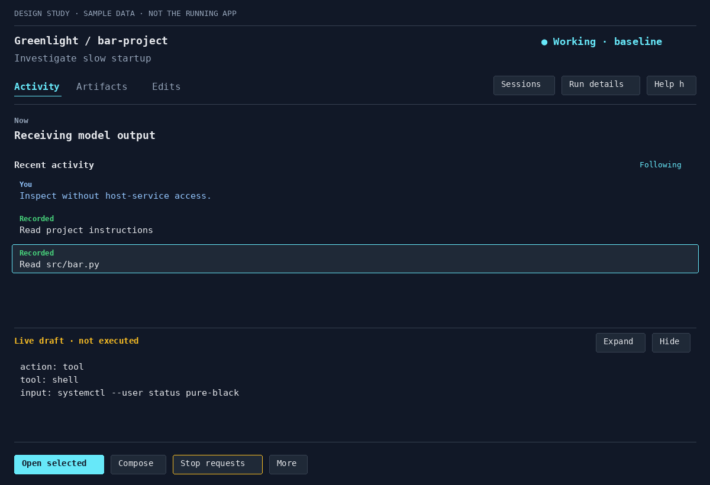
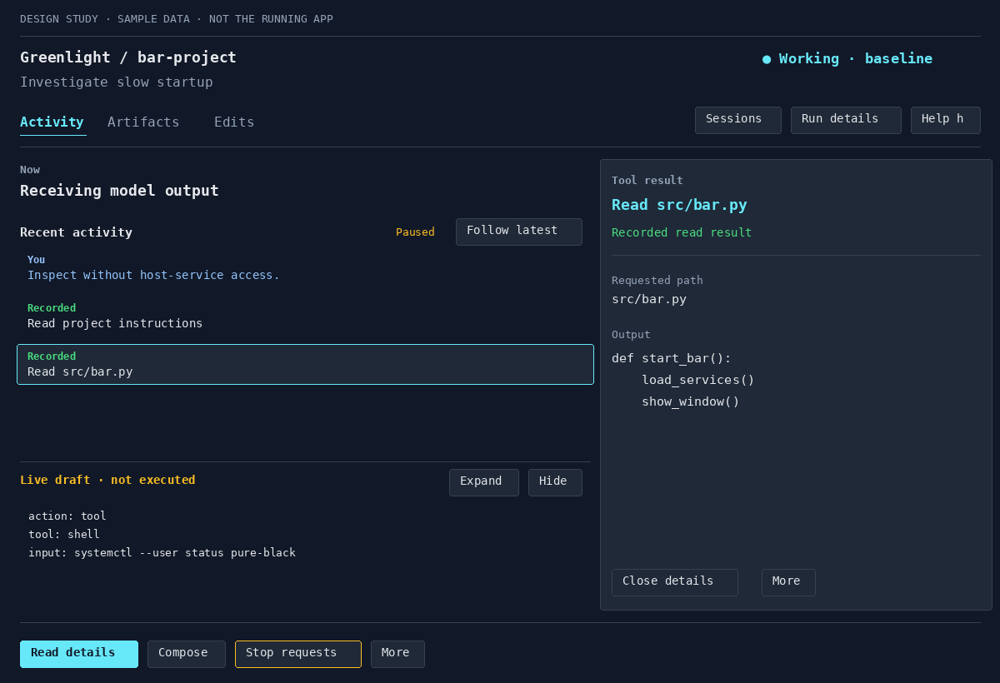
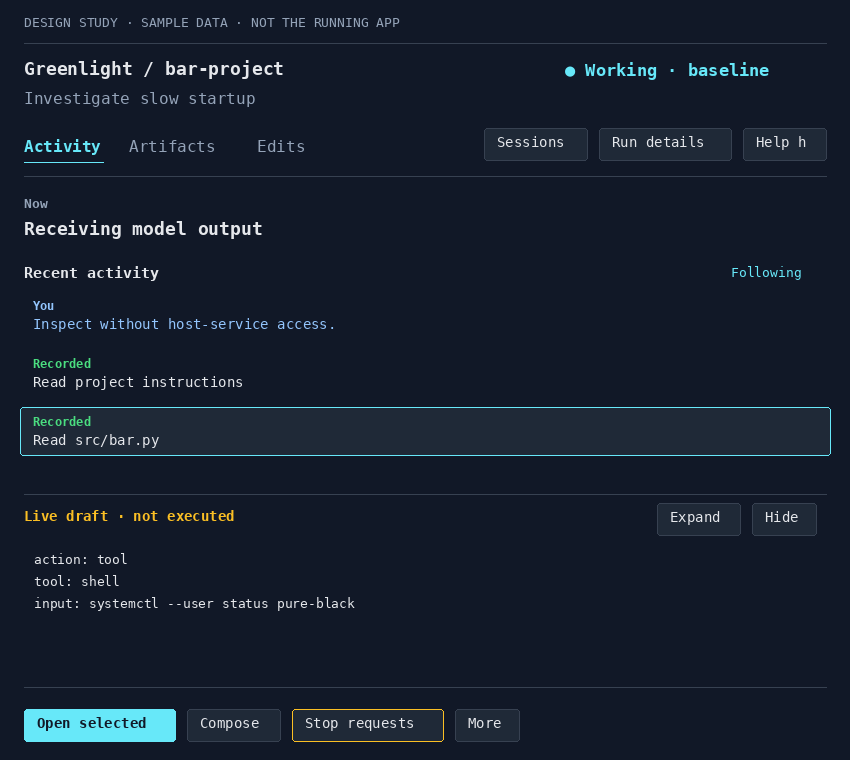

# Running screen — focused design review

**Status:** design-only. The layout choices marked agreed below are user decisions; mockup wording, exact dimensions and interaction details remain a review proposal. No application implementation is authorized by this document.

**Date:** 2026-11-17, Europe/Paris. Builds on the [UI audit and review decisions](23-ui-audit-and-redesign.md). The drawings contain fictional sample content, not results from a real project.

## 1. Decisions agreed in this pass

- **Compact header:** project/session, execution state and current step. The full goal, roadmap, model/attempt/branch metadata belong under Run details.
- **Small live-output preview:** visible during response generation, expandable and hideable. It does not reserve a permanent half-screen pane.
- **Inspector follows selection once open:** opening still requires Enter/click; selecting rows while it is closed does not open it. Once open, deliberate selection changes update it.

These extend the existing choices: hidden-by-default session sidebar, on-demand composer with retained memory-only drafts, semantic colors, default-on mouse with keyboard support/toggle, and contextual `h` Help that can safely overlay a pending approval.

## 2. Visual studies

These are static PNG/SVG design studies, not screenshots or working prototypes. They illustrate hierarchy and example theme colors; they are not cell-accurate proofs that the design fits a particular terminal size. They introduce no runtime, dependencies or model calls. Exact Ratatui wrapping, supported sizes and button/focus rendering need implementation-time validation.

### 2.1 Normal running view

[Editable SVG](mockups/running-wide.svg)

The main content has room because the sidebar, inspector and composer are closed. The screen answers what is happening, shows a short readable activity list and exposes a restrained stream preview. The bottom row contains task actions rather than a general shortcut reference.

### 2.2 Inspector explicitly opened

[Editable SVG](mockups/running-inspector.svg)

The right-hand surface shows the selected recorded result. The list remains usable; the drawing shows reading paused, with an explicit Follow latest action. Follow-selection here means following the user's selection, not jumping to whatever new event arrives.

### 2.3 Compact-width view

[Editable SVG](mockups/running-compact.svg)

The normal view remains a single content surface. At widths where a readable list and inspector do not both fit, opening details replaces the content with a full-width reader and a visible Back/Close control. This drawing does not claim to be an 80×24 render; actual terminal-cell limits remain an acceptance check.

## 3. Regions and their purpose

| Region | Visible content | Opens on demand / deliberately omitted |
| --- | --- | --- |
| Identity | Greenlight/project and a short human session title | Original unabridged goal and project path under Run details |
| Status | A cyan working lamp, truthful phase and current step | No model ID, attempt UUID, raw event number or completion percentage |
| Navigation | Activity / Artifacts / Edits, plus Sessions, Run details and Help | Sidebar stays hidden until opened; current tabs are retained provisionally |
| Now | One current operation, such as Waiting for model output or Receiving model output | No separate permanent context box repeating the goal and required outputs |
| Recent activity | Human labels, meaningful outcomes and role attribution | Raw event kinds, exact IDs and full payloads in inspection/audit |
| Selected item | Clear selection/focus treatment; Open selected action | Does not open or fetch an inspector merely because selection moved while closed |
| Live draft | Roughly four visible wrapped lines while generating, labeled not executed | Expand opens retained output for reading; Hide reclaims space and leaves a small Show output affordance |
| Action dock | Open selected, Compose, Stop requests and More in the illustrated state | No repeated navigation instructions or permanent usage ledger; actions change with state/focus |
| Inspector | Selected tool result/file evidence, when explicitly opened | Session-level Run details uses the same inspector host instead of adding a second drawer |

The number of visible activity rows is determined by the actual terminal size. The mockup's sample count is not a new fixed event limit. Similarly, four preview lines are an initial sizing recommendation, not an accepted exact measurement.

### 3.1 Header

Prefer two short identity/status lines plus the navigation line. A human title can be shortened in navigation if the original goal remains easy to read under Run details. Do not silently rewrite the stored goal or use a model-generated title as the full original request.

The full workflow route/stepper is available in Run details rather than spending another permanent header row. The state badge identifies the current step; it does not imply that work is a fixed percentage complete or that completion will validate the user's goal.

Run details and selected-item details are deliberately distinct subjects. If the inspector already shows an item, Run details changes that surface's subject; it does not create multiple permanent detail columns. The exact Back behavior between those subjects remains a proposal to validate.

### 3.2 Activity

Use normal-contrast readable summaries. User contributions are blue; model-authored intent remains labeled as such; a recorded positive operation may have a green scoped receipt. A green read result does not mean the performance goal was achieved.

Keep selection anchored to the same record during refresh/reordering. New background events do not count as user selection changes. When reading older content, provide a small new-activity indicator and Follow latest action instead of pulling the view to the tail.

A selected row, a focused control and an active tab are different states even if they share the cyan accent. Exact focused-versus-inactive-selection rendering needs visual testing; the study does not settle every focus-state color/border.

### 3.3 Live model output

- Show immediate Starting/Waiting feedback before text arrives, then Receiving output when data actually arrives.
- Keep the short preview distinct from recorded activity. Partial YAML is model drafting, not an approved or executed action.
- Expand/Hide are local viewing operations; neither sends another model request nor cancels the current one.
- Hiding the preview removes its allocated height. Keep a compact indication that output is still arriving and a Show output action.
- Preserve existing terminal sanitization and size limits. The ephemeral preview retains a bounded tail, not necessarily every byte of an arbitrarily long live response. Expanded output must disclose truncation; complete recorded responses remain subject to the existing history/export behavior.
- A preview can update without changing the selected activity or inspector. Expanding output opens a reader with a clear Back target; it does not stack another permanent pane beside the inspector.
- Do not extract an authoritative tool request, availability claim or success badge from an incomplete response.

### 3.4 Composer during a run

Compose opens the editor only on request, restoring its memory-only draft. The recipient/effect must be explicit before submission.

**Current capability constraint:** live instructions to the running coding step are not implemented. A running screen must not imply that an ordinary message was delivered there. Read-only manager questions are supported separately; a proposed composer can expose Ask manager with a clear read-only label, while explaining why direct live instructions are unavailable. Exact recipient/mode presentation still needs review.

Closing the editor keeps its draft and returns the space to the running view. A typed approval that interrupts composition owns input and keeps that draft intact. No second editor should appear active behind the decision.

## 4. Selection, focus and returning from details

The following operational details are proposals consistent with the agreed explicit-open/follow-selection behavior; they are not new runtime bindings.

| Situation | Proposed behavior |
| --- | --- |
| Inspector closed; arrows change row | Only selection changes; no automatic inspector opening |
| Enter/click opens the selected item | Open inspector/full-width reader and make the selected subject clear |
| Inspector open; the list has focus and user selects another row | Update inspector to that row; stale background preparation cannot overwrite the newly selected item |
| Inspector/reader has focus; arrows/scroll wheel move | Scroll that reader, not the underlying activity selection |
| A new event arrives while inspecting | Retain subject and scroll; new activity is discoverable without stealing focus |
| Return to list on wide layout | Keep the inspector open so subsequent deliberate selection can update it; exact Enter/Tab behavior to validate |
| Close details / Escape | Close inspector/full reader and return to the previously selected list item |
| Read an item previously visited | Preserve a useful reading position when available; state is memory-only unless a separate persistence choice is made |
| Narrow terminal | Use a full-width reader; do not squeeze two unreadable panes together |
| A pending approval arrives | Open the request-owned decision surface with exact owner/scope; no click-through or stale keyboard activation |
| Help opens over approval | Approval remains pending; decision keys inactive while Help owns input; Esc returns to the still-valid request |

Opening recorded evidence should retain the existing pause-following principle. A dedicated Follow latest control resumes it. This is independent from following manual selection inside an already-open inspector.

## 5. Actions and feedback

| Action | What it means in this screen | Feedback / boundary |
| --- | --- | --- |
| Open selected | Inspect the current item, without executing it | Show that exact subject; when already open, a label such as Read details can focus it |
| Compose | Open an explicit-recipient editor | No inference merely from opening; draft retained on close; live-agent delivery is not invented |
| Stop requests | Stop future model requests/cancel retry waits through the existing worker control | Show Stop requested. An in-flight response/tool can finish; do not claim process interruption or an immediate stop |
| More | Secondary actions such as Usage, audit/source access and viewing preferences | Only eligible actions, with a readable reason for disabled ones |
| Sessions | Show the hidden session navigator | Current session identity and any pending request owner remain unambiguous |
| Run details | Inspect full goal, roadmap, model and technical context | Read-only; no workflow state change |
| Help | Contextual guidance for this view | Return with selection, draft and scroll preserved |
| Follow latest | Resume following incoming activity | Explicitly changes reading behavior; not a workflow control |
| Expand/Hide output | Adjust the local draft preview/reader | No new request, no cancellation and no change in verification |

The dock is contextual. It should not show a working Stop requests control for a session whose worker belongs to another process, or an active Open selected button when no item is selected. The illustrated screen assumes a local worker and a selected recorded result.

### 5.1 Honest phases

Use only observable facts:

| Available fact | Suitable wording |
| --- | --- |
| Local start accepted, before output | Starting workflow / Waiting for output; finer preparation labels only when known |
| Provider preview is receiving text | Receiving model output |
| Complete response recorded, action processing underway | Response received / Processing action, where observable |
| Recorded tool request without a recorded outcome | Waiting for tool result; do not assume execution started merely because it was requested |
| Typed pending approval | Your decision needed, on the decision surface |
| Retry explicitly scheduled | Waiting before retry, with supported cancellation |
| Another process owns the run | Running elsewhere / Observing; no invented local stream or local approval control |
| Stop flag accepted | Stop requested; current work may finish |

A proposed completion transition should preserve a reader the user is already using and offer View result, while opening the result automatically when the user is following the live view. That broader finished-state behavior remains an open decision for the result-screen review.

## 6. What this pass leaves open

- Exact terminal-cell breakpoints, typography, spacing and preview height.
- Whether Activity should retain its name or become Overview; the drawings retain the current three sections provisionally.
- Header/action placement under very narrow dimensions and when the sidebar is manually opened.
- Composer recipient/mode presentation while coding is active.
- Precise keyboard focus transfer among list, inspector, controls and composer; no existing runtime key changed here.
- Detailed approval, finished-result, artifact and edit-review screens. The general Help-over-approval rule is already agreed, but their composition is a subsequent review.

## 7. Implementation-time checks, not completed validation

Future UI implementation should exercise the closed/open inspector, hidden/expanded draft preview, on-demand editor and opened sidebar at 80×24, a wide terminal and supported smaller sizes. Assert explicit opening, deliberate selection-following, stable reading under new events, correct input focus, stale-reader rejection, current action eligibility and top-layer approval/Help ownership. Mouse and keyboard must use the same eligible actions.

These PNGs have been opened for visual review and the SVGs are editable design sources. That does not replace real Ratatui cell/style assertions or PTY checks. No Rust application tests are claimed for this documentation-only change.
