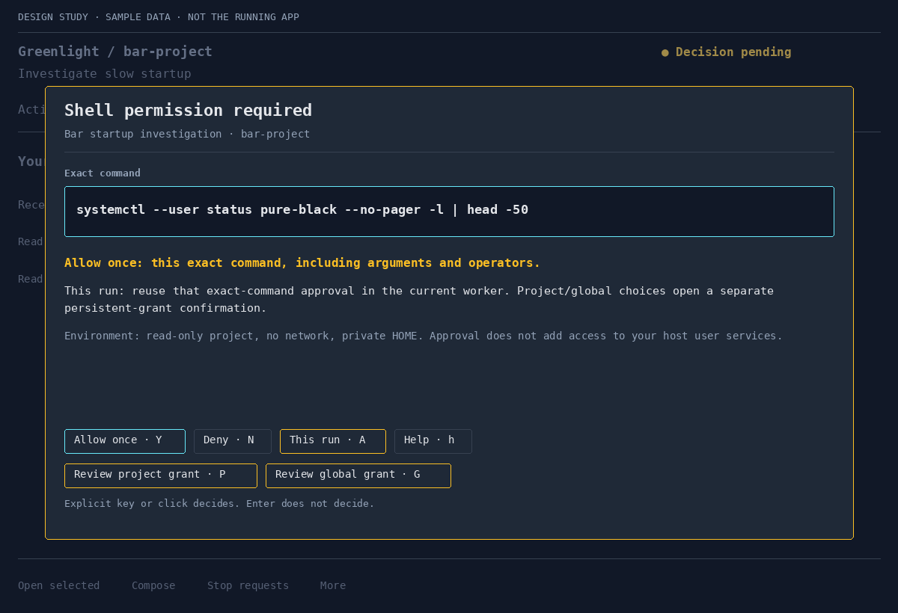
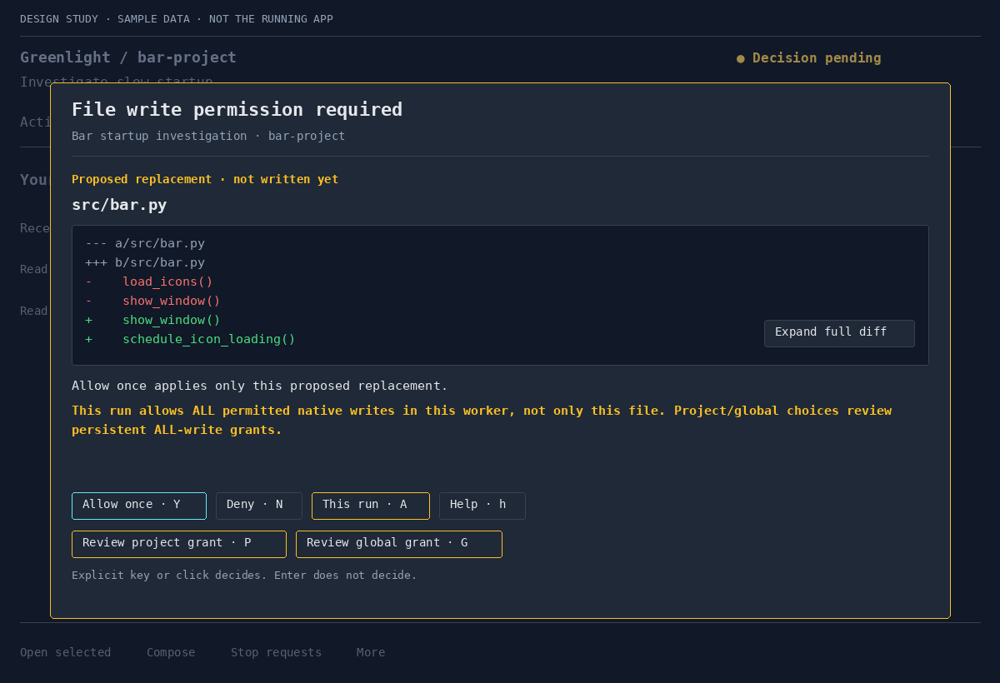
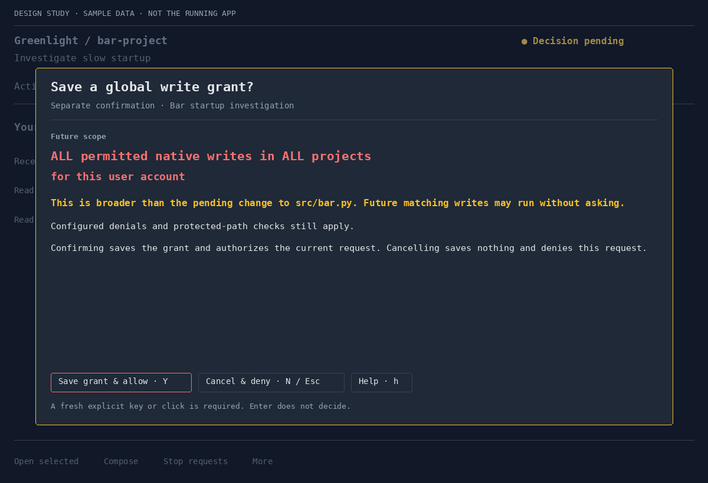
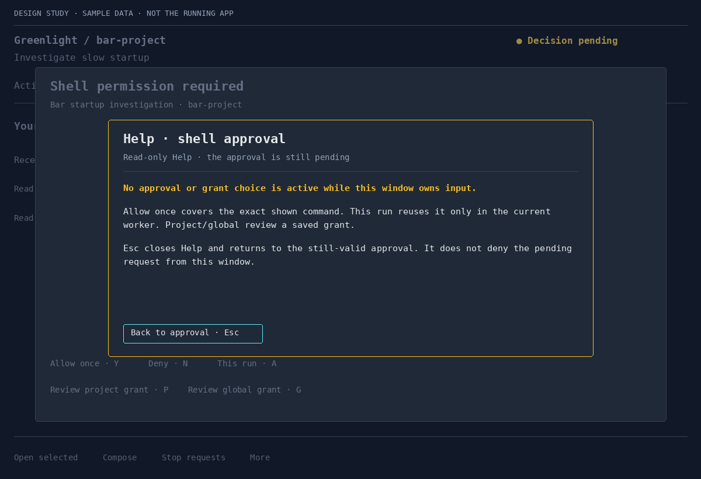

# Approval dialogs — focused design review

**Status:** design only, before implementation. The user selected **every valid grant choice visible immediately**. Exact labels, sizing and focus treatment in these studies remain proposals. No permission policy or application behavior changes here.

**Date:** 2026-11-17, Europe/Paris. Extends the [UI audit](23-ui-audit-and-redesign.md) and the user-approved visual direction of the [running-screen studies](24-running-screen-design.md).

## 1. Main decision surface

Keep the workspace recognizable behind a modal. Show the owning project/session, requested operation, authoritative command or file target, relevant scope and valid actions. Technical request IDs remain inspectable rather than prominent.

All valid choices appear immediately, including the broader grants. They do not move into More or a separate scope-options menu. Project/global choices still open their existing separate confirmation. This is an exception to the ordinary workspace's small action dock.

Buttons show explicit decision keys. Enter remains inert for approval and grant decisions; there is no implicit approving default. Mouse activation uses the same typed decision and eligibility checks as the keyboard. Approval buttons use cyan focus and amber attention; green is reserved for recorded outcomes. Diff additions/deletions retain conventional green/red within the labeled diff.

### Shell request

[Editable SVG](mockups/approval-shell.svg)

The command has a distinct code block. Arguments, pipelines and operators are part of the exact authorized string. Environment limits stay visible: approving a command does not add host user-service access, network access or shell write access. Command-name grants such as allowing every invocation of `cat` remain a separate, unresolved policy design.

### Native write request

[Editable SVG](mockups/approval-write.svg)

Label the diff **proposed replacement, not written yet**, with its exact path. Expand full diff opens a read-only review surface while preserving the pending request. The broader-write warning belongs beside the actions, outside Help: reusable write grants cover all permitted native writes in their scope, not merely this file.

## 2. Only choices valid for the typed request

The source of truth is `ApprovalMode` and the request's tool kind, not words parsed from model output or display text. The current behavior is defined in [tools.rs](../src/tools.rs).

| Request mode | Visible decision choices | Scope |
| --- | --- | --- |
| Human checkpoint | Allow / Deny (`y` / `n`) | Current checkpoint and its exact reviewed evidence |
| Tool: read or web | Allow once / This run / Deny (`y` / `a` / `n`) | Once, or permitted operations of that tool kind in the current worker |
| Persistent: shell | Allow once / This run / Review project grant / Review global grant / Deny (`y` / `a` / `p` / `g` / `n`) | Exact full command string, including arguments/operators |
| Persistent: native write | Same five choices | Once: pending replacement; reusable grants: all permitted native writes in the chosen scope |
| Persistent-grant confirmation | Save grant & allow / Cancel & deny (`y` / `n`) | Display the future scope explicitly before confirmation |

Help is available alongside these choices under the agreed overlay design. A read/web request must not show project/global buttons merely to resemble the shell study.

**“This run” is proposed wording for the current in-memory worker grant.** It lasts for the current `Tools` instance, not a durable workflow session or every subsequent worker in the TUI process. A resumed/new worker does not inherit it. `a` immediately authorizes the request and establishes that in-memory grant; this visual pass adds no extra confirmation.

Configured denials, protected-path rules and sandbox enforcement still apply. Native-write grants do not authorize shell writes. Approval is permission to attempt execution, not evidence that execution succeeded.

## 3. Persistent scope confirmation

[Editable SVG](mockups/approval-global-write.svg)

Project/global review opens a separate confirmation with only its valid decision choices. State both what happens now and what may happen later:

- Shell: reuse approval for this exact command in the project or across projects for this account.
- Native write: all permitted native writes in this project, or across all projects for this account. This is broader than the displayed file.
- Confirm: save the grant and authorize the current request.
- Cancel or Esc: save nothing **and deny the current request**, matching the existing engine contract. Do not label this as Back.

A grant-save failure must be reported separately from a successful save or tool execution. Confirmation is a fresh explicit decision, not a key repeat carried over from opening it.

## 4. Help above a pending decision

[Editable SVG](mockups/approval-help.svg)

`h` / `?` opens read-only contextual Help. The pending decision remains visible but inactive beneath it. No approval shortcut or background click may reach the underlying dialog while Help owns input.

Esc closes Help and returns to the **still-valid** approval; it does not deny from this layer. Esc in the main approval denies; Esc in persistent confirmation cancels the grant and denies the current request. These distinct outcomes must be clear in each surface.

If the worker disappears, ownership changes or the request expires while Help is open, return to an expired/unavailable notice with no actionable stale choices. Opening Help never extends request authority.

## 5. Long evidence, small terminals and focus

Commands, paths and diffs must remain fully reviewable, with wrapping/scrolling or a full-width reader. Keep the owner, scope and pending state recognizable. Never authorize from a clipped critical decision at an unsupported size; preserve the existing small-terminal guard until a tested replacement exists.

The reader is read-only and does not decide. Returning restores the pending request only after checking freshness. Default-on mouse capture and full keyboard operation both apply. Hit regions must come from the current layout and be discarded after resize or layer changes. Prevent click-through when a layer closes; a press begun on one request cannot activate a replacement request.

Current shell requests already carry typed command metadata. A future implementation may need typed native-write path/diff presentation fields so the view does not reconstruct authority from formatted prose. These are presentation data, not new permission scopes.

## 6. Feedback after a decision

Show a short submitted/awaiting-recording state, then the recorded decision or error. Distinguish permission granted, grant saved, execution started, tool success/failure and request expired. A denied or failed operation is not a successful tool result. Keep the engine's evidence inspectable without exposing internal IDs in the default dialog.

## 7. Implementation acceptance checks, later

- Render only choices valid for each typed mode; keep every valid grant visible without opening More.
- Preserve exact shell matching and all-write grant semantics; test once/current-worker/project/global separately.
- Verify Enter is inert, repeated keys cannot decide twice, and keyboard/mouse target the same current request.
- Verify Help captures input, Esc closes only Help, and expiry never restores stale actions.
- Verify project/global cancellation denies the current request and save errors do not display success.
- Exercise long commands/diffs, narrow terminals, resize, focus restoration and mouse press/release across layer changes.

These PNG/SVG drawings use fictional content and illustrative colors. They are not screenshots, clickable prototypes or terminal-cell fit tests. Application code, dependencies, permission matching and runtime keybindings are unchanged.
