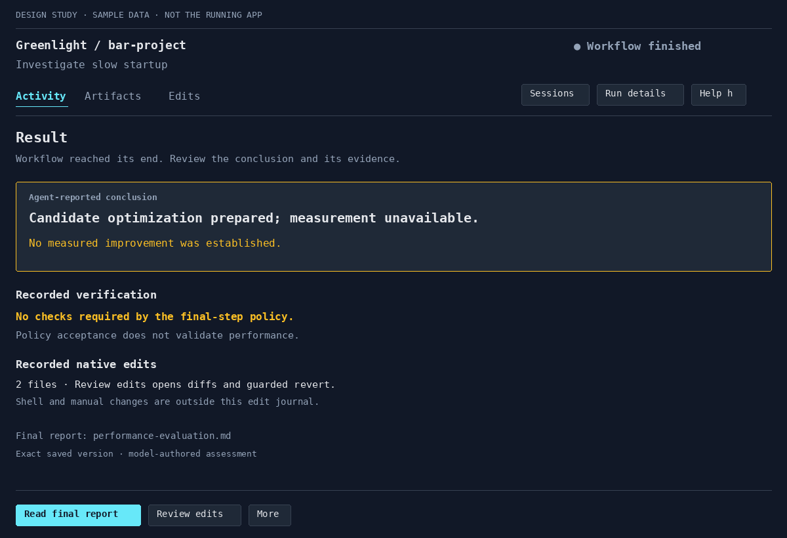
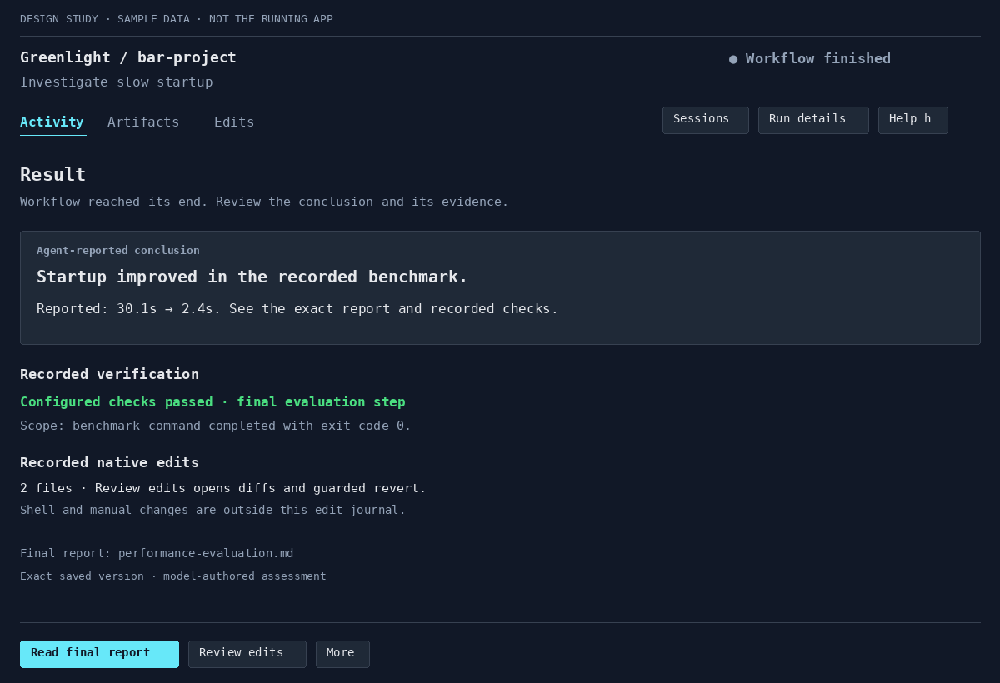
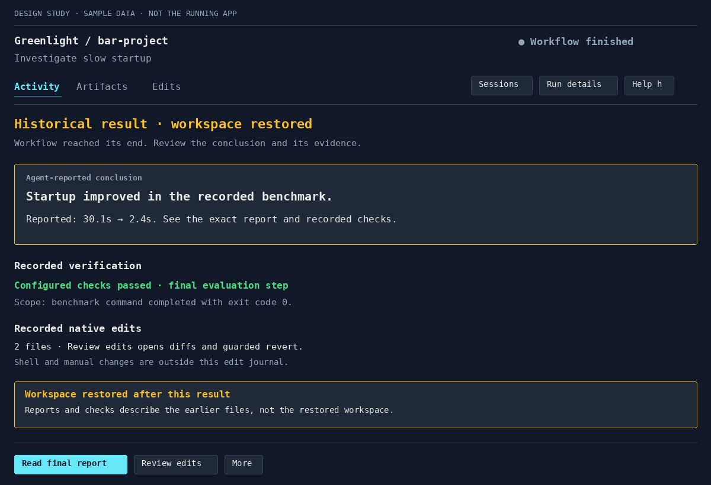

# Completed workflow — focused design review

**Status:** design only. The user approved the overall completed-screen visual direction; exact labels, sizing and detailed interactions remain proposals. Continues the approved [running-screen visual direction](24-running-screen-design.md), semantic colors and on-demand panels. The user has authorized this design pass, not UI implementation or a new outcome classifier.

**Date:** 2026-11-17, Europe/Paris. Builds on the [UI audit](23-ui-audit-and-redesign.md) and [approval design](25-approval-dialog-design.md).

## 1. What this screen must answer

1. What did the agent conclude?
2. What evidence was actually recorded, and what remains unknown?
3. What files did Greenlight record changing?
4. What can I review or do next?

A completed workflow reached its terminal step. It may have produced a proposal, an unsuccessful experiment or a report explaining why measurement was impossible. Its header therefore says **Workflow finished**, without a green goal-success lamp. The conclusion and verification remain separate.

The default landing content is a Result overview inside Activity, not a fourth permanent tab. Detailed activity remains available through More → Recorded activity and a visible return-to-result action. The exact Activity/history shortcut remapping is still open; `h` is reserved for Help in the agreed design.

## 2. Visual studies

These are static fictional PNG/SVG illustrations, not screenshots, working prototypes or proofs of terminal-cell fit. They use existing recorded-data concepts. No model call generates or classifies the summary in this proposal.

### Measurement unavailable

[Editable SVG](mockups/completed-unmeasured.svg)

This addresses the user's bar-startup example: the agent says it prepared a candidate, the workflow finishes, but no measured improvement is established. A native-edit count says edits were recorded; it does not establish that those edits improved performance. If the report only proposed changes, the count can instead be zero.

### Recorded checks passed

[Editable SVG](mockups/completed-checks.svg)

Green belongs to the recorded check result. The claimed performance gain remains attributed to the agent/report. An exit code of zero proves only the configured command's recorded success criteria, not independently the reported 30.1s → 2.4s improvement. Full check output and exact report versions must be inspectable.

### Workspace restored after completion

[Editable SVG](mockups/completed-restored.svg)

A clear historical-result heading and amber notice explain that the old report/checks describe the earlier files. Keep the original evidence; do not silently rewrite its conclusion or present it as validation of restored files. The count remains a count of recorded file paths, not files still modified now.

## 3. Elements and interactions

| Element | Default content | On deliberate opening |
| --- | --- | --- |
| Compact header | Project/session and Workflow finished | Run details: full goal, roadmap, attempts, branch and technical metadata |
| Result heading | Current result, or Historical result when a recorded restore invalidates workspace correspondence | No extra permanent pane |
| Agent-reported conclusion | Short saved final-step summary with attribution | Exact recorded summary and final report; long text remains fully readable |
| Recorded verification | Final-step policy verdict and its scope; no-checks state explicit | Exact command/agent/human checks, their results and evidence |
| Recorded native edits | Number of recorded file paths; native-journal coverage stated | Edits tab: net recorded diffs, history gaps, no-net-change/reverted state |
| Final report reference | Human-readable filename and exact-version indication | Full-width reader or inspector, tied to that immutable version |
| Task actions | Read final report, Review edits, More | Additional actions depend on evidence, selection, ownership and capabilities |

The sidebar, composer and inspector remain closed by default. An opened inspector follows deliberate selection, not incoming background events. Long conclusions wrap or open in a reader; do not use an unexplained ellipsis as the only available conclusion. Narrow terminals stack the same information and use full-width readers, preserving selection and scroll positions.

No raw event IDs, UUIDs, full shortcut legend or permanently empty composer appear in the default layout. Provenance and exact record references remain available in Details. A compact factual message may show a pending action or failure; it must not overwrite the conclusion.

## 4. Evidence and wording rules

The current [result summary](../src/tui/result.rs) already separates final-step policy acceptance, agent-authored conclusions, exact report versions, recorded edits and post-completion restore warnings. This design reorganizes those concepts; it does not infer truth from prose.

| Evidence state | Proposed wording / treatment |
| --- | --- |
| Workflow reached terminal step | Workflow finished, neutral lamp |
| Final-step policy requires no checks | No checks required by the final-step policy; amber explanation that this is not measured validation |
| Configured aggregate policy passed | Configured checks passed, explicitly scoped to the final step and inspectable checks |
| No aggregate verdict recorded | No recorded verification verdict; amber, never guessed as passed |
| Agent claims improvement or failure | Agent-reported conclusion, neutral body text with source link |
| Agent reports unavailable measurement | Attribute that finding; show the limitation clearly without inventing a verified classification |
| Final report missing/unreadable | Say which evidence is unavailable and offer artifacts/activity; do not substitute another report silently |
| No native-edit records | No recorded native edits; this does not prove the workspace was untouched |
| Restore after result | Historical result; checks describe the earlier workspace |

“Improved”, “failed” and “unmeasured” can occur in saved model summaries. A trustworthy goal-level badge would require a separate structured evidence contract; there is none added here. The studies' outcome sentences are fictional authored examples, not deterministic classifications of arbitrary Markdown. Do not search for words such as “success” to choose a lamp.

The final-step verdict is not an all-workflow guarantee. Earlier attempts and earlier step results belong in Details/activity with their provenance. Reports and check output may disagree; preserve both and expose the disagreement rather than merging them into a manufactured success.

Native-edit counts follow branch-visible records. The [edit journal](../src/tui/edits.rs) is not a Git diff or a complete account of shell/manual writes. A recorded restore is a known reason to mark a result historical; absence of that event does not guarantee files still match the tested workspace. External/manual drift must not be described as detected unless it actually was checked.

## 5. Actions and feedback

- **Read final report:** opens the exact version associated with the result, not an unrelated latest artifact. If absent, replace it with Review available evidence and explain why.
- **Review edits:** opens Edits with per-file diff inspection. Keep a usable empty state when no native edits were recorded.
- **More → Recorded activity:** opens evidence/history with a clear Back to result action.
- **More → Ask manager:** opens the on-demand composer in explicit read-only manager-question mode, using the existing `/ask` capability. This makes a provider request; show submitted/running/answer/failure feedback. It does not resume or edit the completed workflow.
- **More → Restart from step:** opens the existing step/restart review path only when eligible. It is not a one-click retry and does not promise a benchmark the harness cannot run.

Revert remains inside Edits: select a file or all recorded edits, review the reverse diff, then explicitly confirm. Opening a diff never reverts. Preserve drift/history-gap/ownership checks and confirmation freshness; Enter does not authorize destructive confirmation. Manual pre-existing work must not be force-overwritten. Workspace-only revert does not rewind history or resume the workflow.

After a successful restore show a concise receipt and historical-result notice. If restoration fails or is partial, show a diagnostic with the recorded state and supported recovery guidance, without claiming everything was reverted. Missing history and another worker's ownership disable unsafe actions with an explanation.

Merely arriving at this screen never runs a summarizer, retries a step or invokes the manager. Switching to older completed sessions never triggers model calls. No automatic promotion of report instructions into executable commands.

## 6. Transition and accessibility checks for later implementation

- Open Result once when the selected locally observed workflow completes; preserve drafts. Do not steal focus from an active decision, Help, editor, explicit reader or another session. Offer a completion notice when immediate navigation would interrupt the user.
- After leaving Result deliberately, background refresh must not repeatedly reopen it. An explicit Result action returns to it.
- Bind report, verdict and edit records to the selected session/branch/completion boundary. Never combine another run's result with this run's files.
- Verify empty/missing reports, no edits, no checks, scoped passing checks, conflicting model claims, historical results and read errors.
- Test stale reports after restore, edit drift, partial restore failure, observation-only ownership and disabled actions.
- Validate minimum sizes, wrapped long goals/conclusions, keyboard focus, mouse hit regions and text labels without color. Exact sizes, fonts, action labels and keybindings remain to validate in Ratatui.

## 7. Next design pass

Review this Result hierarchy, then cover blocked/error/interrupted states, session creation and composition. Detailed Edits/revert surfaces also need their own pass before implementation. Application code, permission policy and runtime behavior remain unchanged by these assets.

Implementation follow-up: the compact evidence-scoped overview and exact-report action are now rendered in Ratatui. See [actual cell-grid captures](screenshots/README.md); the drawings above remain historical visual studies.
