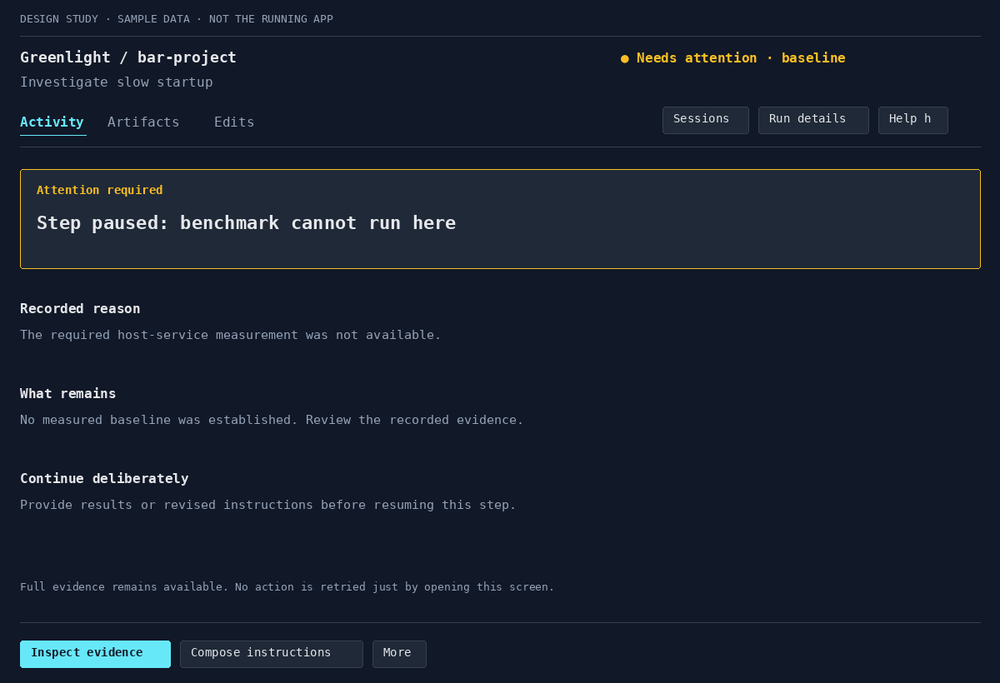
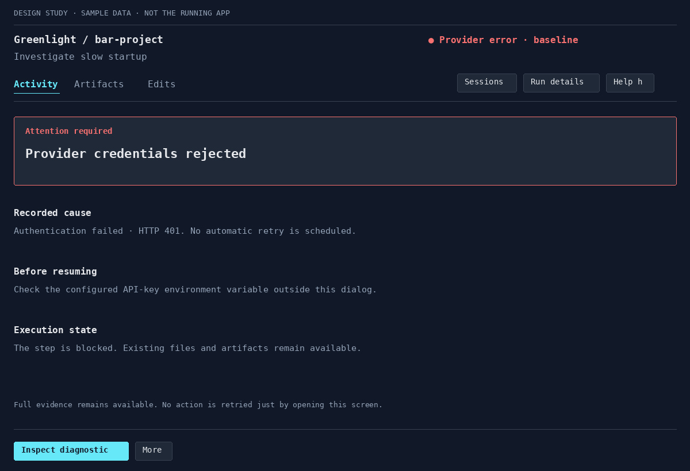
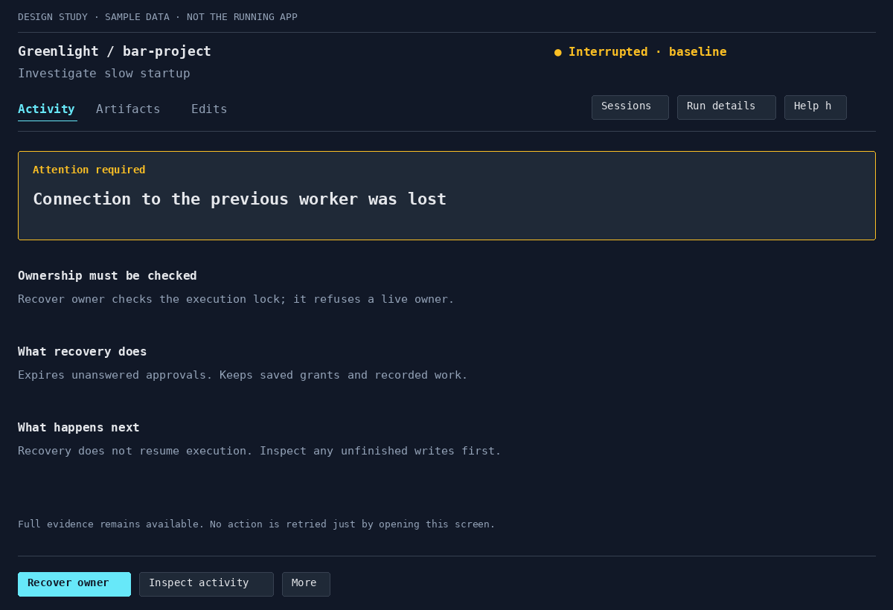
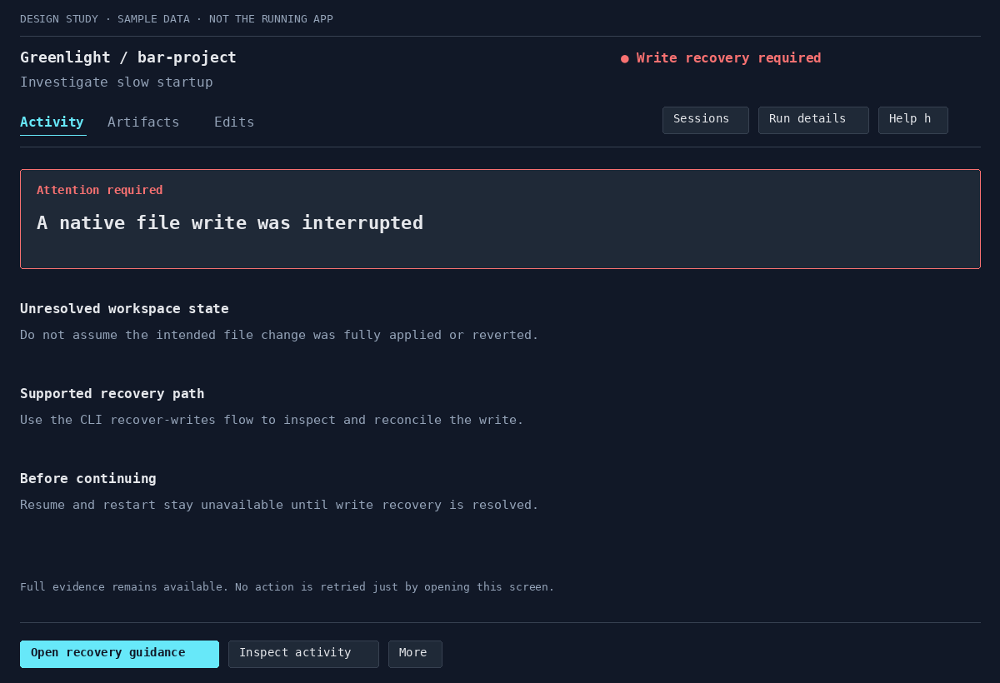

# Attention and recovery — focused design review

**Status:** design proposal only, before implementation. The user approved the completed-screen visual direction and requested the next pass. This document applies the existing semantic colors, compact header, on-demand panels and contextual actions to blocked, provider-error and interrupted states. Exact wording and interaction details remain proposals.

**Date:** 2026-11-17, Europe/Paris. Builds on the [UI audit](23-ui-audit-and-redesign.md), [approval dialogs](25-approval-dialog-design.md) and [completed results](26-completed-screen-design.md).

## 1. Common structure

Keep attention in the workspace rather than automatically replacing it with a full-screen technical diagnostic. Show a prominent short cause, what remains unresolved and one useful next action. Exact evidence opens deliberately in an inspector or full-width reader. Closing that reader leaves the attention state visible; it does not acknowledge, resolve or retry anything.

The header shows the project/session, current step and an amber attention or red error label. Color supplements text. The sidebar, composer and inspector remain closed by default. Technical IDs and long stack/context details remain inspectable.

These are presentation states derived from recorded engine/provider/ownership information, not new persisted session statuses or a classifier of model prose. When the cause is unknown, say so and offer recorded activity. A protocol error inside a still-running correction loop is not automatically a blocked session.

## 2. Four visual studies

The PNG/SVG assets use fictional sample data and illustrative dimensions. They are not screenshots, working controls or terminal-cell fit tests.

### Blocked step

[Editable SVG](mockups/attention-blocked.svg)

Show the recorded reason and its consequence. Inspect evidence is the primary action; Compose instructions is a visible secondary action when the session can actually resume. No generic Retry button implies that repeating the same request will fix the cause.

The host-measurement example does not introduce an `ask_user` tool or automatically collect journal logs. The user can supply results through the existing resume-instruction path. A future structured wait-for-user capability remains separate work.

### Provider failure

[Editable SVG](mockups/attention-provider.svg)

Show the typed provider failure category, safe recorded status and specific advice. Do not echo raw response bodies, API keys or secret environment values. The example is a terminal authentication failure with no automatic retry pending; it does not represent an active retry wait.

### Interrupted ownership

[Editable SVG](mockups/attention-interrupted.svg)

A lost local worker connection expires that worker's pending approval UI. Recover owner checks the lock and refuses a live owner. It does not prove death from elapsed time, a PID or a stale Running label. Observation of a live external owner instead uses the existing observation-only presentation; no recovery takeover is offered as an eligible action.

### Interrupted native write

[Editable SVG](mockups/attention-write.svg)

Give write reconciliation its own surface and priority over Resume/Restart. Open recovery guidance explains the supported CLI `recover-writes` flow, including how to identify the actual project/record. It does not pretend that the TUI already implements a one-click repair or choose a recovery outcome for the user. Full paths and recovery records belong in the reader, where they remain reviewable.

## 3. Actions must match the recovery path

| State | Primary action | Other eligible actions | Action effects |
| --- | --- | --- | --- |
| Blocked, idle and no pending writes | Inspect evidence | Compose instructions; More → Resume without instructions / Restart from step / Ask manager | Inspection is read-only; explicit resume starts a worker |
| Terminal provider failure | Inspect diagnostic | More → Resume when ready / Ask manager / Recorded activity, where eligible | No automatic retry merely from viewing the screen |
| Active provider retry wait | Stop requests | Inspect retry details / Recorded activity | Cancels retry waits; an already in-flight request may finish |
| Interrupted owner | Recover owner | Inspect activity | Lock-guarded ownership cleanup; no execution resumed |
| Live external owner | Inspect activity | Read artifacts/details | Observation only; no competing worker, takeover or approvals |
| Unfinished native write | Open recovery guidance | Inspect activity and write record | CLI reconciliation required before further execution |
| Failed/partial restore | Inspect recovery diagnostic | Read workspace/history and supported guidance | Do not imply all files were restored or expose a force-overwrite shortcut |

Compose instructions must explicitly target the workflow step. It cannot silently become a manager question because routing is enabled. If the existing router proposes clarification or a target, preserve that interaction and show the selected mode. Ask manager is a distinct read-only question path and may itself fail when the provider is unavailable.

Resume repeats neither the whole workflow nor a destructive restore: it invokes the supported ready/blocked continuation with optional instructions. Restart from step opens selection, reverse-diff preview and explicit confirmation. The current restart flow restores and forks to a checkpoint, then requires instructions or `/resume`; it must not say the restarted agent is already running.

## 4. Provider-specific guidance

Use the typed failure contract in [provider_failure.rs](../src/provider_failure.rs); do not infer billing versus rate limiting from HTTP 429 alone.

| Recorded category | Visible explanation / next step |
| --- | --- |
| Credentials | Key missing, invalid or expired; check configured variable and replace/reload outside this screen |
| Billing | Credit or billing quota exhausted; check account limits/balance; automatic retries disabled |
| Rate limit | Explain recorded wait/retry state; show Retry-After only when supplied and applicable |
| Permission / rejected request | Check model access, request/context or configuration as indicated |
| Service / connection / timeout | Specific service/connectivity advice; distinguish terminal failure from an active bounded retry |
| Protocol / unknown | Safe failure description and recorded diagnostic; no invented cause |
| Cancelled retry | No further retry sent; resume explicitly when ready |

Never promise live credential reload. Some configuration changes may require restarting the TUI. A new Resume request uses whatever configuration the actual worker loads. Automatic retry policy remains unchanged: only backend-authorized retries occur, not every transient-looking error. Show a countdown only if reliable retry timing is available; otherwise say Waiting for provider retry.

When processing/billing is uncertain, state that the request may have been processed and automatic retry is disabled. Do not turn missing usage into zero tokens or zero cost. Do not offer an immediate Retry action while a worker or retry is already active.

## 5. Recovery feedback and safety boundaries

The [owner recovery implementation](../src/session_execution.rs) acquires the owner lock, expires unanswered approvals, preserves saved grants and leaves execution stopped. Normally a recovered unfinished session becomes blocked; a completed session remains completed. Show the actual returned state, not an unconditional Ready badge.

Proposed receipts:

- Recovering owner → ownership recovered; no work resumed; inspect unfinished writes before continuing.
- Recovery refused → another owner still holds the lock, or the actual error; no takeover performed.
- Instructions submitted → worker startup pending/running, or a clear rejection with the draft retained.
- Resume refused → explain owner, write, configuration or state prerequisite; do not clear evidence.
- Restart prepared → review restore/fork consequences; explicit confirmation required, Enter inert.
- Restore/fork failure → explain whether workspace restoration occurred before the failure; inspect history before trying again.

These labels must reflect recorded outcomes, not optimistic UI transitions. A freshness check is required at activation even if a button appeared eligible at render time. No double submission from key repeat or mouse press/release across a session/layer change. Reuse the same typed action and guards for mouse and keyboard.

Pending approvals retain their dedicated decision layer and Help behavior. A new diagnostic must not cover an authoritative command or activate background controls. Help is read-only and Esc closes only Help; Esc from an evidence reader returns to the unresolved attention view. No dismissal grants permission or resumes work.

## 6. Compact layout and later acceptance checks

At narrow widths stack reason, consequence and next action; open full-width evidence. Long diagnostics must be scrollable and copyable with safe export handling. Keep text labels alongside colors and explain disabled actions. Preserve draft, selection and reading position across resize and close/reopen.

Before implementing, verify:

- Unknown cause, long errors, missing/corrupt evidence and historical diagnostics do not manufacture a current blocking reason.
- Authentication/billing/ambiguous 429/active rate-limit retry/timeout with uncertain processing show the correct distinct advice and actions.
- Live external ownership, lost worker connection, available-lock recovery and expired approvals stay distinct.
- Recovery does not resume, revoke saved grants or repair native writes implicitly.
- Pending writes, partial restores and restore-then-fork failures prevent misleading success receipts or unsafe restart shortcuts.
- Observation, session switching, resize, Help layering, input focus and mouse freshness retain the existing authority boundaries.

No new model calls, recovery mechanisms, permission scopes or runtime changes are introduced. Next design passes: session creation and composition, then detailed Edits/revert review.

## Attention and recovery slice — 2026-11-17

Implemented concise cause/impact/next-action screens for blocked steps, typed provider failures, retry waits, interrupted ownership, unfinished native writes and external-owner observation. Explicit actions open exact evidence, full diagnostics, step instructions or read-only manager questions. Owner recovery retains the backend lock guard and never resumes; write recovery is guidance only. Partial restore failures warn that some files may already have changed. Manager failures and stale coding failures do not mislabel the current step. Full diagnostics retain complete evidence while default previews are bounded.

Verification: 305 tests passed, one existing test ignored; 106 TUI tests passed. Actual Ratatui captures at 80×24, 120×36 and 40×14 are indexed in [screenshots](screenshots/README.md). This completes the attention/recovery presentation slice, not the remaining run-details, checkpoint or Edits Keep-review work.
