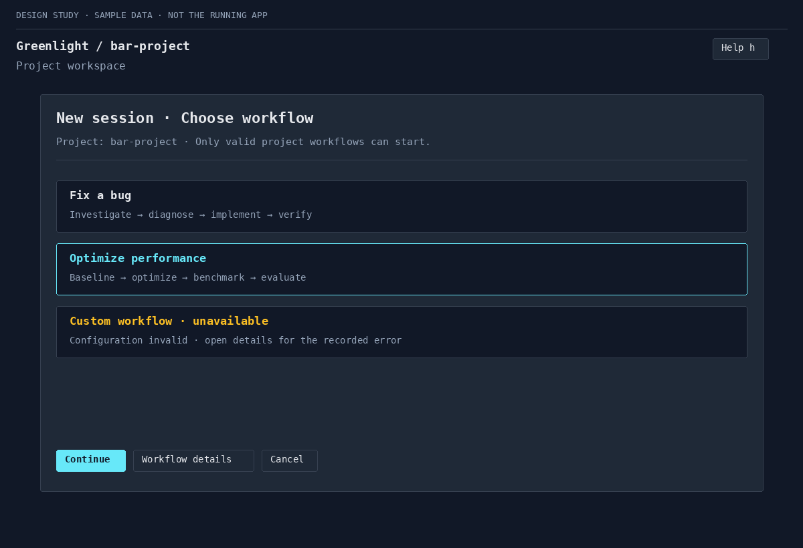
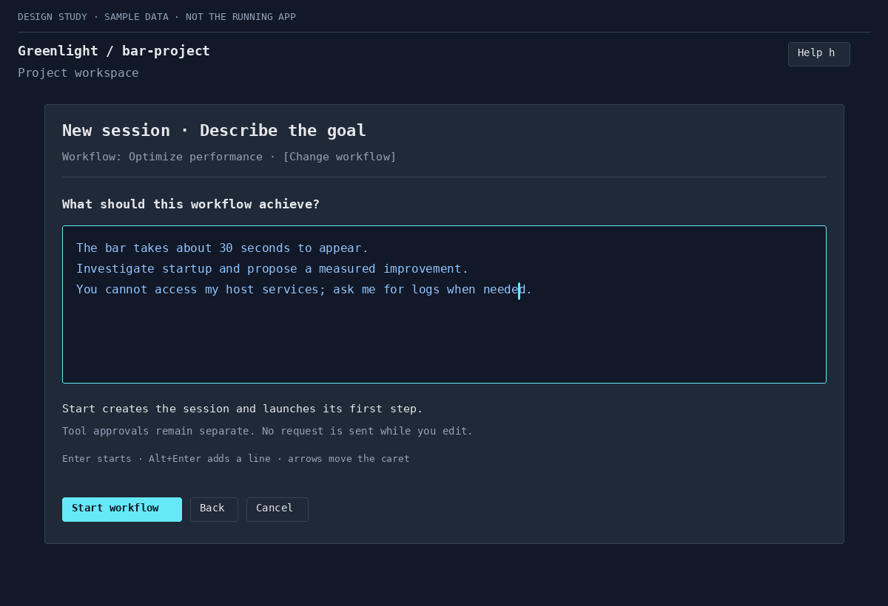
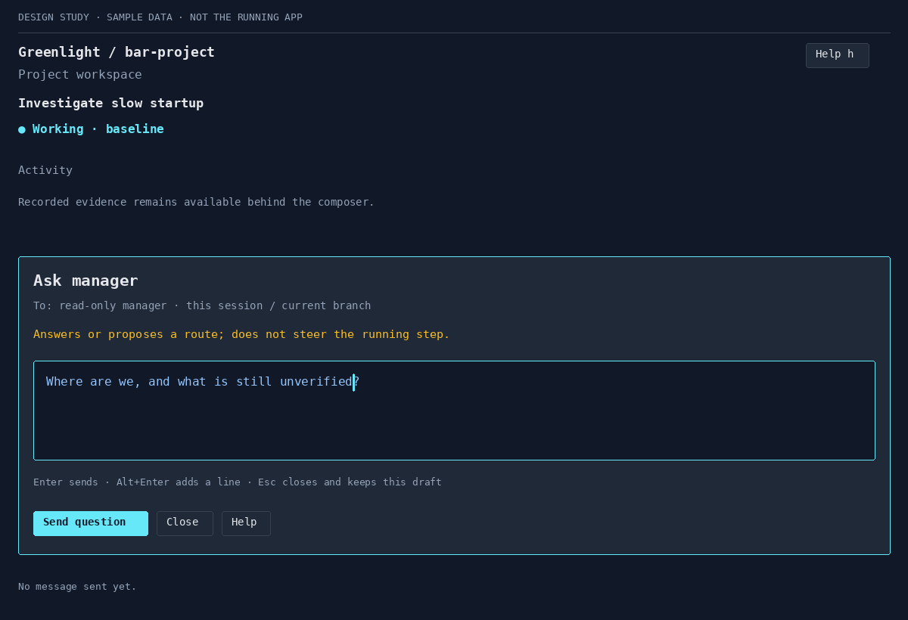
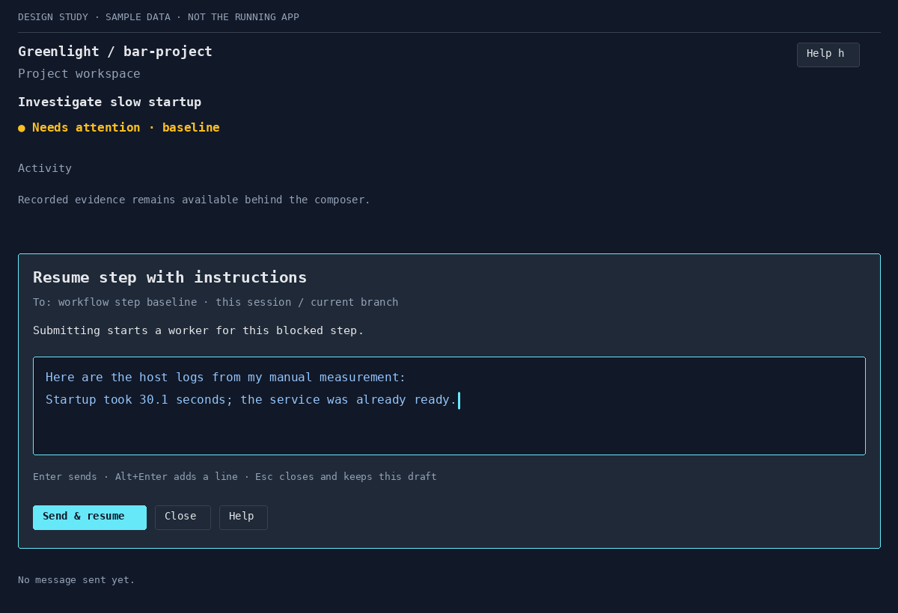

# Session creation and composition — focused design review

**Status:** design proposal only. Continues the agreed on-demand composer, retained memory-only draft, blue user text, cyan focus, default-on mouse and complete keyboard operation. Screen wording, mode selection and detailed behavior below remain proposals for review; no application implementation is authorized here.

**Date:** 2026-11-17, Europe/Paris. Builds on [running screens](24-running-screen-design.md), [completed results](26-completed-screen-design.md) and [attention/recovery](27-attention-and-recovery-design.md).

## 1. Creation flow

A visible New session action, also reachable with `n` in navigation, opens a focused two-stage surface: **choose workflow → describe goal**. It does not create a session or call a provider merely by opening or selecting a workflow. Keep the current project visible throughout; do not add a project-switching feature as part of this flow.

### Choose workflow

[Editable SVG](mockups/create-workflow.svg)

Show human-readable workflow titles, with a compact roadmap for the selected valid workflow. The sample roadmaps are illustrative; derive actual step information from valid workflow definitions rather than inventing descriptions. Workflow details opens the full definition/step context. Invalid workflows stay visible with an Unavailable label and inspectable validation reason, but cannot continue.

Arrows select, Enter or Continue advances, and Cancel returns to the workspace. Selection alone does not open an inspector or start execution. No workflows found is a clear empty state with project-specific configuration guidance, not a blank list. Reload/revalidate on submission because files may change while the form is open, as the current [session picker](../src/session_picker.rs) already does.

### Describe goal

[Editable SVG](mockups/create-goal.svg)

Show the selected workflow and a Change workflow/Back action, a large focused editor and **Start workflow**. Keep the literal goal blue and UI instructions neutral. Explain the action once near submission: **creates the session and launches its first step; tool approvals remain separate**.

Back preserves the in-progress goal while changing workflow. Propose that Cancel closes creation and retains this unsent creation draft in memory, with an explicit Discard draft action available on reopening; this extension beyond the existing composer retention requires implementation. It does not create a durable project draft. Do not silently persist or substitute a previous goal when starting another session.

Blank/whitespace goals cannot start. Show validation beside the editor and keep the draft/caret. Revalidate workflow, project and pending-write prerequisites on Start. A successful create followed by worker-start failure must show the created session and actual error; retrying must not create duplicate sessions.

## 2. Start feedback

On explicit Start:

1. Show Starting workflow immediately and prevent duplicate submissions.
2. Create/select the session and start the worker through the existing validated path.
3. Show the actual current step and a waiting-for-provider state; distinguish connection/waiting from receiving output.
4. Display the agreed small live preview only when output arrives; approvals use their own dialog.
5. If creation/start fails, show a specific reason and preserve the goal or link the already-created session as appropriate.

Do not leave the user on an unexplained Ready record after Start. Do not promise a precise wait duration or fake streaming while waiting. No provider calls happen during draft editing or workflow browsing.

## 3. Open the composer with an explicit purpose

Compose opens on demand rather than occupying every workspace. Its mode and target must be visible before submission. A small purpose choice can appear when more than one mode is valid; opening it must not infer a route, call the manager or send text.

| State | Eligible composition purpose | Submit action |
| --- | --- | --- |
| Local workflow running | Ask manager, read-only | Send question |
| Idle ready/blocked step with prerequisites satisfied | Resume step with instructions; Ask manager | Send & resume, or Send question |
| Completed workflow | Ask manager | Send question; restarting is a separate reviewed action |
| Interrupted owner / pending write | Explain recovery prerequisite; manager question only if backend permits | No workflow resume until recovery permits it |
| No selected session | New session | No manager question without session context |
| Live external owner | Read-only manager question only where backend permits | No instruction delivery or competing worker |

Mode labels represent capabilities, not a promise of an implemented new router. The current [manager UI](../src/tui/manager_ui.rs) saves a question and performs read-only inference; suggested routes do not execute. Normal text can currently route through the manager when enabled. A future Resume-step control must use an explicit supported workflow-instruction path, not accidentally send ordinary text into that manager path.

### Ask manager

[Editable SVG](mockups/compose-manager.svg)

Show **To: read-only manager · this session / current branch**. Say that it answers or proposes a route and does not steer the running step. Send question starts a provider request and may incur usage. Preserve existing message-size validation (currently 12 KiB), saved-message evidence and failure receipts. A second send while a manager job is active is refused with the draft retained.

### Resume step

[Editable SVG](mockups/compose-resume.svg)

Show the exact selected step and **Send & resume**. Explain that submission starts a worker for that idle ready/blocked session. This is not live steering, a queued message to a running agent, or a durable wait-for-user tool. No unavailable “send to running step” mode is shown as actionable.

A request to retry a completed step instead enters the reviewed restart path; merely changing a composer label cannot bypass restore/fork semantics. Recipient/session/branch changes invalidate a pending submit until the target is reviewed again. Never deliver a retained draft to a newly selected session silently.

## 4. Editing and focus

Use the existing [grapheme-aware editor](../src/tui/editor.rs) as the baseline. All focused text fields have a visible blinking caret when the terminal supports it; retain a visible static caret fallback. PNG studies show a single caret phase and cannot demonstrate blinking.

- Left/right moves through graphemes; up/down moves within wrapped multiline text, not between sessions or panes. Support Home/End and deletion consistently.
- Keep Enter to submit/start, matching current behavior. Alt+Enter adds a line; Shift+Enter may also work where the terminal distinguishes it. Document terminal limitations and provide the existing external-editor route for longer text.
- Keep submission/editing hints local to the active editor, without restoring the global static shortcut bar.
- While typing, letters such as `h`, `n`, `x` and slash-like content are text. Help is reached through a visible focusable control or an explicit non-text navigation gesture, not by stealing typed characters.
- Tab/Shift+Tab moves between field and controls; arrows inside the field edit. Mouse click places the caret, scrolling keeps the draft readable, and controls use fresh layout hit regions.
- Paste inserts literal text, including newlines, without submitting or activating shortcuts. Bracketed-paste handling and unsupported-terminal fallback need explicit implementation/testing; current support must not be assumed.

Treat visible recipient choices as structured actions rather than asking users to memorize `/ask` or `/resume`. If slash-command entry remains, separate it deliberately from literal message mode so pasted logs beginning with `/` cannot unexpectedly execute a command. This is an interaction proposal, not a current parser change.

## 5. Drafts, receipts and closing

Esc/Close closes the composer and retains its unsent memory-only draft. Help opens read-only without submitting or clearing it; closing Help restores editor focus/caret. Creation uses its own draft, separate from a session message.

Propose memory-only drafts keyed by selected session/branch and purpose so manager questions and step instructions do not overwrite or misroute one another. This extends the current single composer and needs implementation; the accepted retention direction does not imply crash recovery or on-disk draft saving. Clearly label a restored draft's target. Explicit discard clears only that draft.

For every submission show distinct receipts: validating/submitting, accepted/saved, worker or manager running, answered/completed, refused/failed. The UI should clear the submitted draft only once the relevant backend acceptance is known; keep a recoverable copy or saved-message reference if later startup/inference fails. Do not imply that a saved manager message reached a workflow step.

Cancellation stops future manager retries through the existing mechanism; an in-flight request may finish. It is not immediate force-kill. A reply belongs to its original session/branch even if the user switches context. Show a quiet completion notice and link the saved reply rather than interrupting another editor or approval.

## 6. Compact layout and later verification

On small terminals use a full-width creation/editor view with readable target, field and submit action. Grow/scroll the editor within available space; do not permanently shrink the activity report. Preserve text, caret and selection across resize, Help and external-editor return. Exact row counts and minimums require real Ratatui renders.

Later implementation checks should cover invalid/missing workflows, revalidation after file changes, blank goals, duplicate Start, create-success/start-failure, delayed provider feedback, Unicode/wrapped caret movement, multiline paste, draft mode/session changes, stale ownership and pending writes, manager errors/size limits, and keyboard/mouse action equivalence. Opening/closing any editor must make no model calls.

No application code, runtime keys, message routing or persistence changes in this pass. Next: detailed Edits/revert design and a final cross-screen consistency review before implementation planning.
