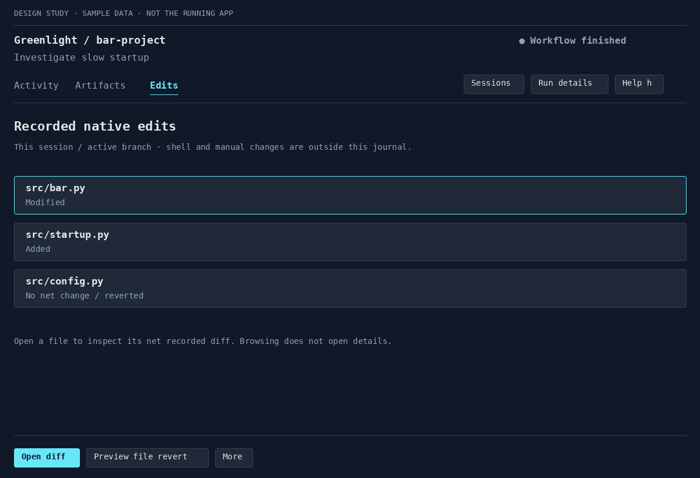
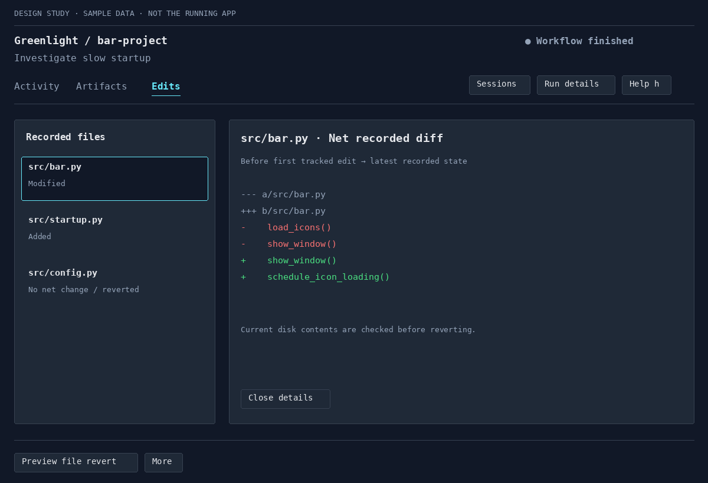
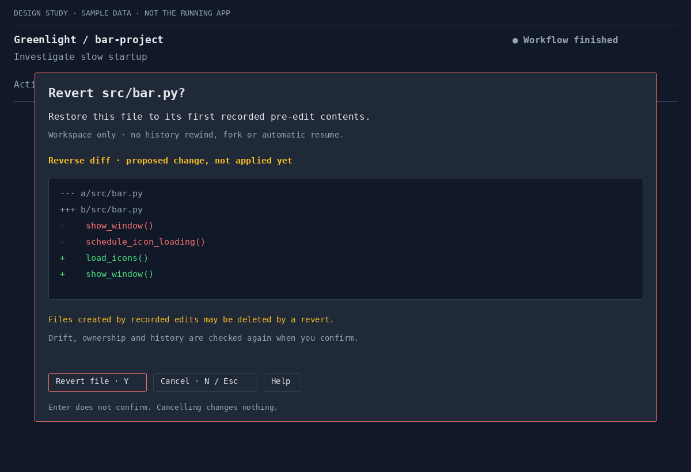
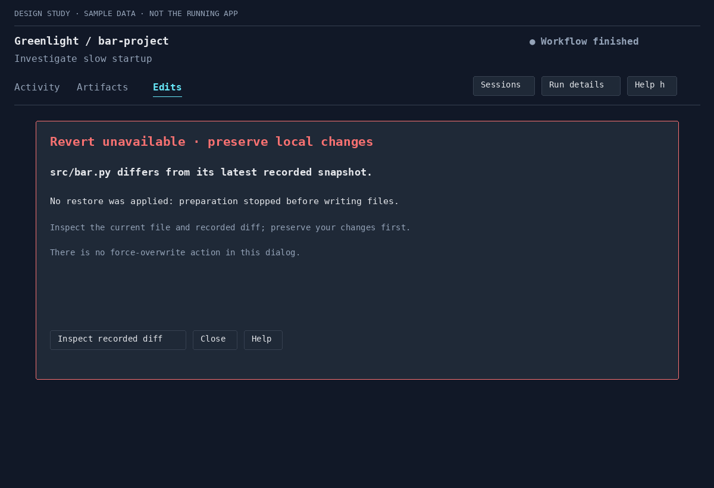

# Edits and revert — focused design review

**Status:** design proposal only. Applies the agreed quiet list browsing, explicitly opened inspector, semantic colors and contextual actions. Exact labels and mechanics remain review proposals. No application implementation or restore-policy change here.

**Date:** 2026-11-17, Europe/Paris. Builds on [completed results](26-completed-screen-design.md), [recovery](27-attention-and-recovery-design.md) and the [cross-screen consistency review](30-ui-consistency-review.md).

## 1. Coverage and default view

Edits means **recorded native edits for this session's active branch**, not Git status or all machine changes. State that shell/manual changes are outside the journal. Artifacts are documents and belong in Artifacts, not this file list.

[Editable SVG](mockups/edits-list.svg)

List path and recorded state: added, modified, deleted, no net change/reverted, or history gap. Selecting a row while details are closed does not open a reader. Enter/click or Open diff opens it. Keep file path text neutral, selection cyan and problematic history amber/red with a text label. Addition/deletion markers within diffs use conventional green/red; these do not imply success/error outcomes.

The example contains three recorded paths, including one with no net change. Do not call all three currently modified. Counts must state whether they mean recorded paths or net changes. Empty state: No recorded native edits, plus the coverage explanation. Unreadable journal: Edits unavailable with an inspectable error, never an empty-success state.

## 2. Opened inspector

[Editable SVG](mockups/edits-inspector.svg)

Show the full selected path and label **Net recorded diff: before first tracked edit → latest recorded state**. It is not automatically a comparison against current disk contents. The current file is checked during revert preparation and again as required by the restore engine; don't claim drift was checked just from browsing this diff.

Once explicitly open, the inspector follows deliberate file selection. Background refresh does not steal the reader or change the selected file unexpectedly. Close details returns to the same list position. Narrow terminals use a full-width diff reader with a visible Back action. Long paths/lines remain fully inspectable, with whitespace-preserving scrolling or wrapping and readable addition/deletion prefixes without color.

## 3. Revert preview and confirmation

Preview file revert prepares a plan for the selected path. More → Preview all recorded reverts prepares a plan across recorded paths. Neither action mutates files. The all-files preview must name the session/branch, actual affected files and operations; it is not a selected-row action disguised as All.

[Editable SVG](mockups/edits-revert-preview.svg)

The modal identifies the exact target and shows the **reverse diff**, labeled Proposed, not applied yet. Explain: restore first recorded pre-edit contents; workspace only; history/artifacts retained; no fork or automatic resume. Explicitly show deletion of a file created by the recorded edits and restoration of a recorded deleted file where applicable.

Use explicit `y` / click Revert file (or Revert recorded files) and `n` / Esc Cancel. Enter remains inert. Do not preselect an approving destructive action. Full preview is scrollable/readable; opening Help or expanding evidence cannot confirm. Esc closes Help first, then cancels only when the confirmation owns input. Read-only Help over this confirmation is a proposed extension of the agreed approval-layer pattern.

## 4. Refusal and failure states

[Editable SVG](mockups/edits-revert-conflict.svg)

This example is specifically a **preparation refusal before any files were written**. It can therefore say No restore applied. Do not reuse that sentence for an application failure whose outcome may be partial.

| Condition | Presentation and supported action |
| --- | --- |
| Current file differs from latest recorded snapshot | Explain drift; inspect recorded diff and preserve local changes before retrying; no force-overwrite action |
| History has a gap | Explain possible out-of-band changes; inspect evidence; no automatic revert of that selection |
| Already at target / no net change | No files need changing; no destructive confirmation |
| Live worker / external owner | Explain ownership; keep inspection available; no competing restore |
| Interrupted owner / pending write | Open the appropriate recovery guidance, not a generic retry |
| Session, branch, history or target changed since preview | Discard stale plan; require a fresh preview and explicit confirmation |
| Partial restore or journal failure | Show exact available failure evidence; some files may have changed; inspect workspace/history before proceeding |
| Restore succeeded, receipt recording failed | Say the workspace may already have been restored; do not encourage blind retry or claim full evidence was saved |

The [current Edits flow](../src/tui/edits.rs) checks selected session, branch and history freshness, while [RestorePlan](../src/restore.rs) checks locks, pending writes, snapshots and history continuity. Preserve those contracts. Per-file preparation is scoped to that file; unrelated drift need not prevent a safe selected-file revert. All-files preparation may refuse because one included path is unsafe; it must not silently skip that path and call the operation complete.

Multi-file application is **not an all-or-nothing transaction**. A later file/journaling failure can occur after earlier updates. Show a successful receipt only for the recorded successful outcome; preserve failure/recovery evidence otherwise. Preflight refusal and partial application require different copy.

## 5. Receipts and navigation

After confirmed successful revert, refresh the list and show **Recorded edits reverted; history retained; rerun checks against restored files**. Preserve selection if it still exists. Previously completed reports become historical where recorded restoration establishes that distinction; the workflow is not restarted or marked newly verified.

Cancelling changes no files and returns to the same diff/list. A stale preview has no active confirmation controls. Mouse/keyboard use the same typed action and request context; key repeat and click-through cannot apply twice or act on another file. For too-small terminals preserve the pending plan but prevent destructive activation while critical evidence cannot be presented safely.

Later verification should exercise added/deleted/modified/net-zero paths, per-file versus all-file scope, pre-existing work, drift/history gaps, no-op state, stale session/branch/history, pending writes, ownership, partial writes/journal failures and historical-result warnings. Test actual terminal wrapping, diff prefixes, Help layering and explicit activation. No model calls or Git reset/checkout are introduced by this view.

These four PNG/SVG studies use fictional data and illustrative dimensions. They are not screenshots, prototypes or terminal-cell fit tests. Application code and restore behavior remain unchanged.
