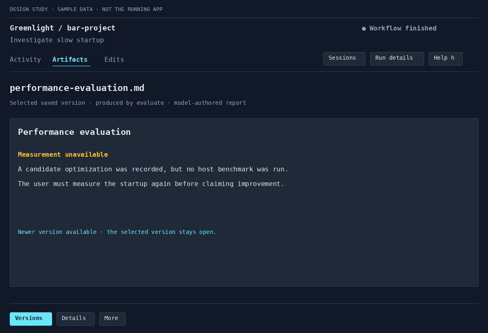
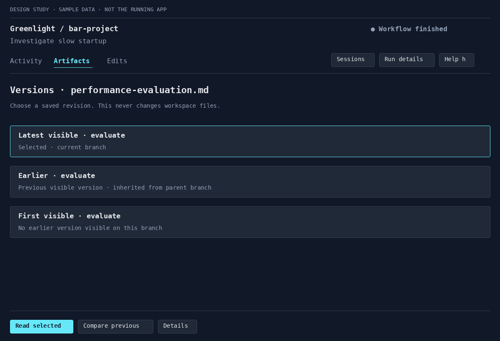
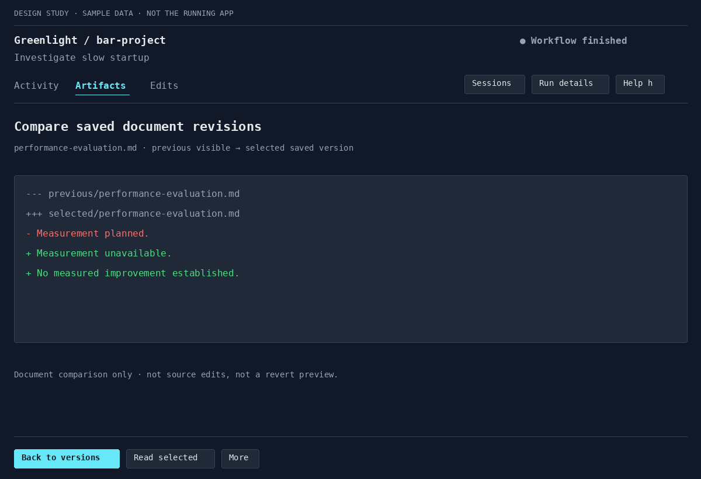
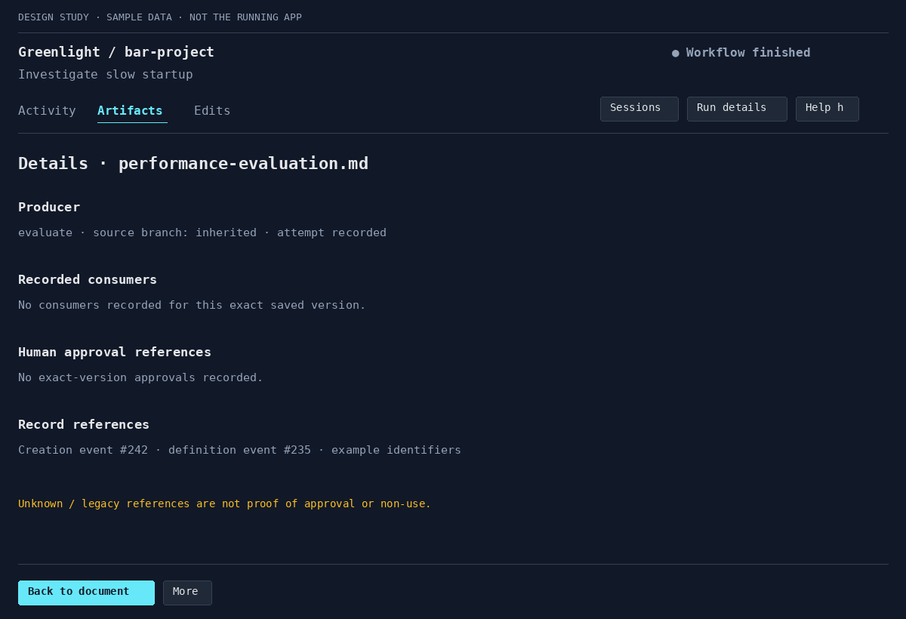

# Artifacts, versions and provenance — focused design review

**Status:** design proposal only, 2026-11-17, Europe/Paris. Uses the agreed explicitly opened inspector/full-width reader, quiet browsing and semantic colors. Exact controls and labels remain proposals. No runtime changes or new model calls.

Builds on the [UI audit](23-ui-audit-and-redesign.md), [completed results](26-completed-screen-design.md) and [Edits review](29-edits-and-revert-design.md).

## 1. Artifact list and reader

Artifacts are saved workflow documents, separate from recorded workspace edits. The default list shows filename, producing step and compact available metadata. Selection stays quiet until Enter/click/Open document; once open, deliberate selection updates the inspector. Wide layouts can split list and reader; narrow layouts replace the content with a full-width reader and explicit Back to artifacts.

[Editable SVG](mockups/artifact-reader.svg)

The reader shows the document name, selected-version identity and producer without permanently exposing UUIDs. Markdown is the default for Markdown content, with a labeled Raw text toggle under More. Model-authored content stays visually distinct from UI metadata; a heading in a report is not a verified application status.

Opening a result or evidence reference resolves to its **exact saved version**, not whatever has the same filename now. If a newer visible version appears, keep the version being read and show Newer version available with an explicit action to open it. Do not reset scroll or silently replace evidence under the reader. The sample banner illustrates this proposed notice, not an implemented control.

Provide Versions, Details and More actions near the reader. More includes supported Copy/Open externally routes with clear receipts, plus Back/Close. Export/open identifies the exact version and whether the payload is the complete saved original or a bounded preview. Do not imply a full export when the underlying route only supplies a clipped viewport. The current implementation's export contracts remain authoritative until explicitly changed.

## 2. Version selection

[Editable SVG](mockups/artifact-versions.svg)

Versions are immutable records visible through the selected session's branch ancestry/cutoffs, newest visible first, as defined in [artifact_history.rs](../src/artifact_history.rs). Show selected version, producer, time and inherited status where applicable; exact record IDs remain available in Details. Relative labels such as Latest visible do not replace stable event identity internally. Display timestamps with an explicit timezone/offset rather than an ambiguous local time.

Choosing a row selects; Read selected opens it deliberately. Once a version reader is already open, deliberate version selection can update that reader under the same inspector rule. Compare previous means the immediately older **visible** version, not a hidden revision from another branch. First visible version has no predecessor: show that explanation and disable the comparison action.

Versions do not restore source files, change workflow branches or rerun a step. A missing selected blob is an unavailable-body error tied to that record, never a silent fallback to a newer/older version. Branch/session change requires revalidating visibility; retain only reading state valid for that scope.

## 3. Document comparison

[Editable SVG](mockups/artifact-compare.svg)

Name both endpoints and direction: previous visible → selected saved version. Show a whitespace-preserving textual diff with addition/deletion prefixes and conventional colors. This is **document comparison**, not Edits, source undo or a revert preview. No Revert file button appears here.

Identical versions say Identical content. Missing bodies, no predecessor and size refusal each have specific explanations. The current comparison rejects versions above 256 KiB per body and never diffs clipped text; retain that guard. Offer complete-original export guidance for an external comparison rather than producing a convincing but incomplete diff. The design does not add arbitrary endpoint selection or cross-branch comparison.

## 4. Details / provenance

[Editable SVG](mockups/artifact-provenance.svg)

Details answers who produced this exact version, which recorded consumers used it, and whether a human checkpoint referenced it. Show producing step, source branch/inherited status, attempt/definition availability, creation time, recorded consumers and exact-version approval references. Technical IDs are appropriate in this deliberately opened evidence surface and remain copyable.

Provenance may gain consumers/references while document content stays immutable. Refresh those references without changing the selected version or jumping the reader. Human approval references are not shell tool grants or the proposed Keep-file review marks. A report saying “approved” is not a recorded checkpoint.

Legacy records without version IDs cannot be attributed. Malformed manifests and missing attempt metadata must show unknown/unavailable warnings. None recorded means no attributable record in the visible history, not proof that nobody ever read or approved the document. Do not fabricate links or jump to unrelated evidence if a referenced record is unavailable.

## 5. Reader feedback and edge states

| State | Treatment |
| --- | --- |
| No artifacts | Clear empty state; explain that documents may appear as the workflow runs |
| Metadata discovery failure | Specific error, not a fabricated empty list |
| Large document preparation | Preparing preview; preserve responsive controls and reject stale preparation results |
| Bounded/truncated display | Persistent Preview truncated label and supported complete-original export guidance |
| Raw text mode | Same terminal-safe rendering and explicit limits; not an unlimited/unescaped display |
| Body missing/unreadable | Exact selected record identified; metadata/provenance may remain reviewable |
| Version no longer visible | Unavailable in this branch; return to a valid list, no silent substitution |
| Evidence changes in background | Quiet notice; preserve selected version, reader focus and scroll |

The [existing reader](../src/tui/reader.rs) prepares large viewports in a bounded worker. Rendering must remain terminal-safe and preserve truncation notices; Raw is not permission to render escape sequences as controls. No document text or embedded command/link auto-executes on selection. External open/copy uses the supported safe path and explicit action.

## 6. Navigation and later checks

Esc/Back returns one level: provenance/comparison → the version/document context that opened it → artifacts/workspace. Help captures input and returns to the same selected version. Preserve per-session/branch reading positions, plus separate scroll for content/provenance/comparison where implemented; richer per-mode positions are a proposal, not a persistence promise.

Ordinary focus/control traversal applies here. The user-requested Tab-to-cycle-files exception belongs only to the Edits review region, not artifact versions. Visible Versions/Compare/Details actions avoid requiring Git or memorized terminal keys.

Later checks should cover explicit-open/follow-selection behavior, exact-version result links, inherited versions/cutoffs, missing bodies, legacy approvals, corrupt manifests, identical/first/oversized comparisons, safe raw rendering, truncation/export labeling, async stale results, resize, Help and keyboard/mouse equivalence. Static drawings are fictional examples, not cell-accurate terminal acceptance tests.

Next design pass: session navigation/empty home, human checkpoints, run details/usage and Help. The focused screen set is not yet a complete replacement specification for every audited surface.

Implementation follow-up: artifact list density, contextual document/version controls and the dark reader presentation have landed. [Actual Ratatui renders](screenshots/README.md) distinguish the implemented surfaces from the broader proposed version/provenance interactions above.
