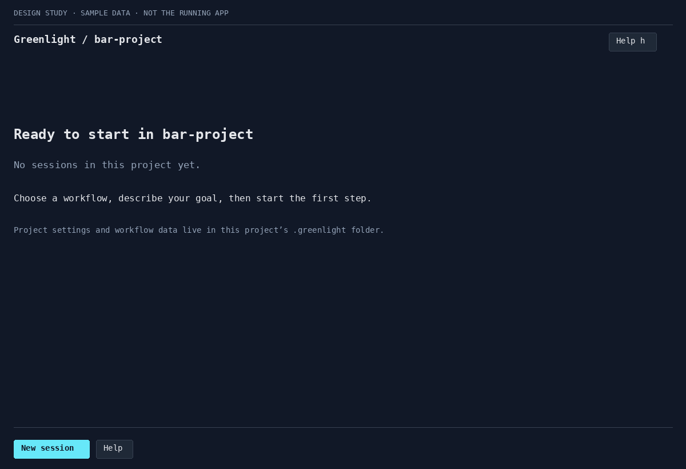
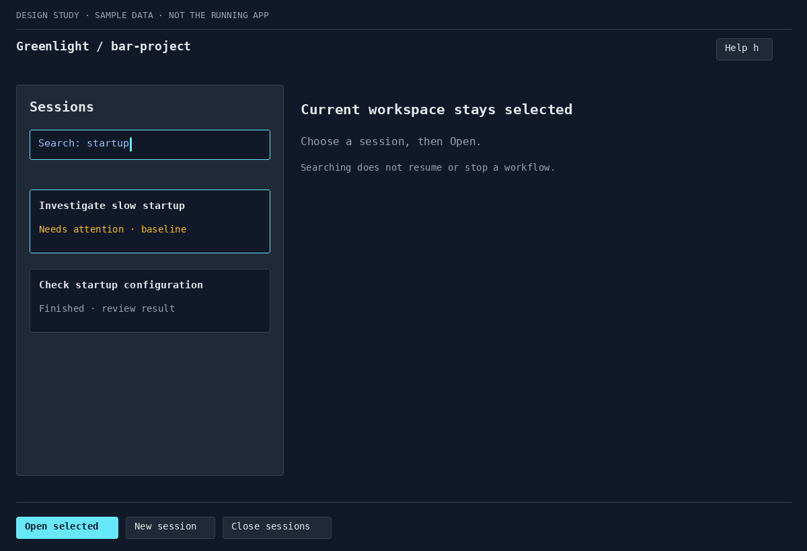
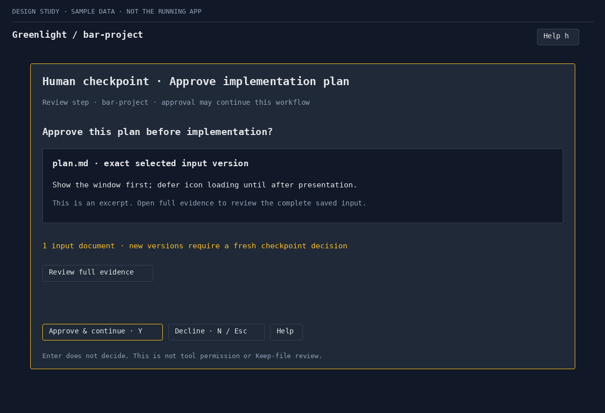
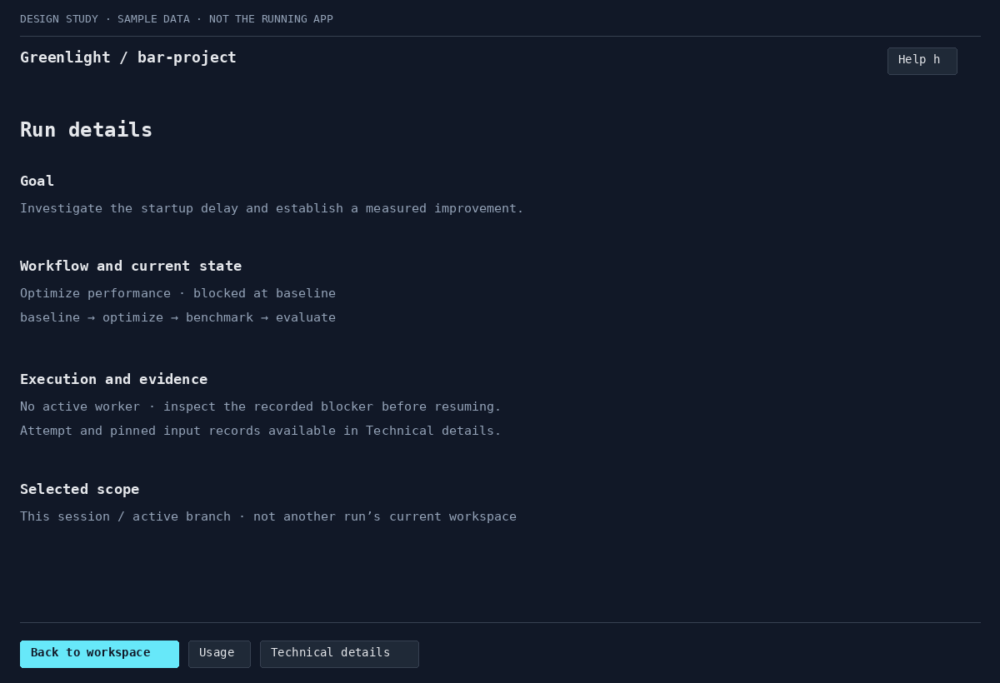
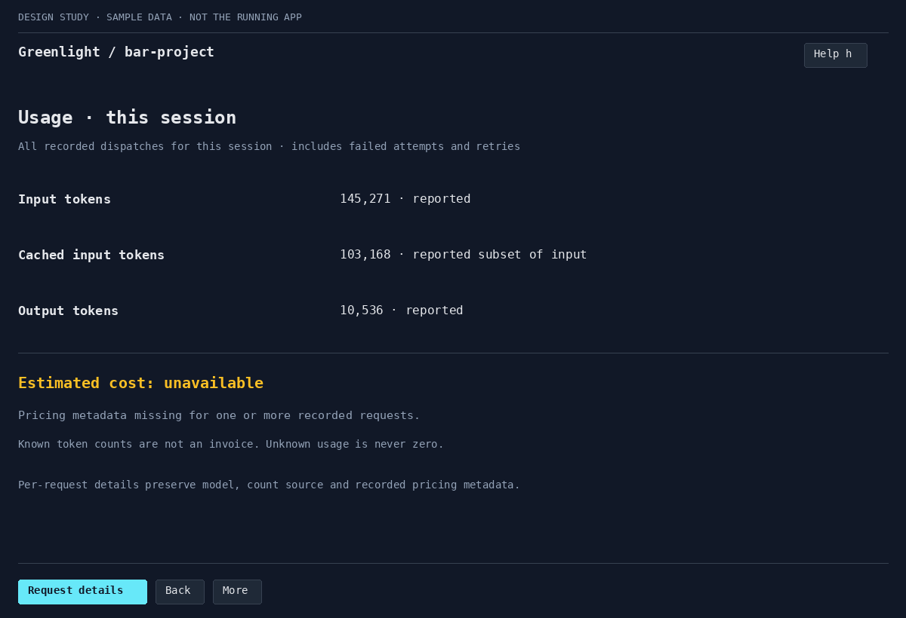
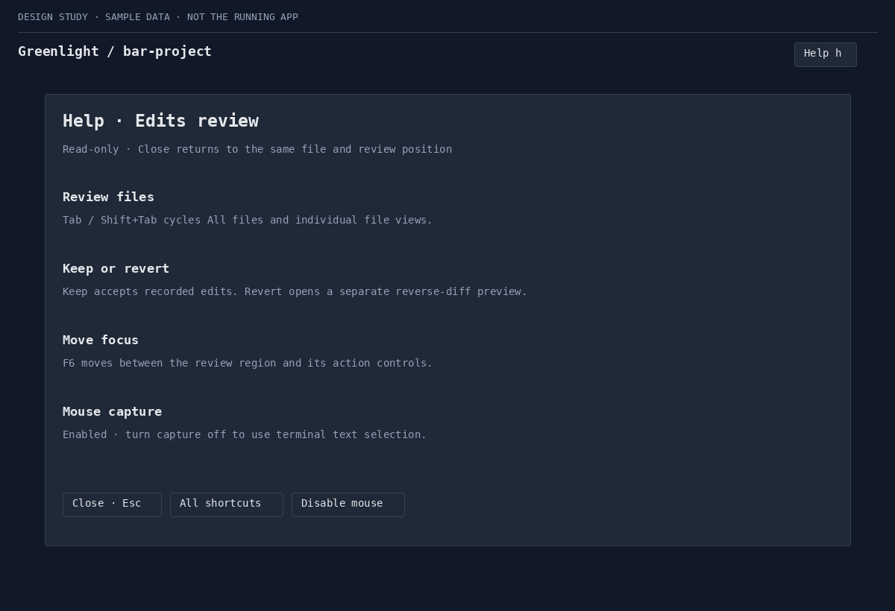

# Navigation, checkpoints, details and Help — focused design review

**Status:** design proposal only, 2026-11-17, Europe/Paris. Continues the user-selected visual direction. The user's request to continue does not settle every label or interaction below. No application code, keybinding, permission or persistence changes.

Builds on the [audit](23-ui-audit-and-redesign.md), [consistency review](30-ui-consistency-review.md), [Edits review amendment](29-edits-and-revert-design.md) and [artifact reader](31-artifact-reader-and-history-design.md).

## 1. Empty home

[Editable SVG](mockups/home-empty.svg)

Show the actual project name, No sessions in this project and one clear New session action. Help is secondary. No empty sidebar, UUIDs, usage zeros, blank composer or nonfunctional Start control. If the project uses a legacy layout, show its actual setup in Details rather than falsely claiming its data already lives under `.greenlight`. The study assumes the current project-local layout.

Distinguish no sessions from no search matches, missing configuration/workflows, and failed session discovery. No matches offers Clear search; setup errors explain the supported configuration path. Never replace a database/load error with a welcoming empty-success state. Opening home never calls a model or creates a session.

## 2. Session navigation

[Editable SVG](mockups/sessions-sidebar.svg)

Sessions opens a sidebar hidden by default, or a full-width picker when narrow. Search is an explicitly focused blue text field with blinking caret. Rows show a short human goal/title, labeled status/current step and useful recency when space allows. Full goals and technical IDs remain inspectable. Keep the existing blocked-first/recent ordering unless a separate sort feature is agreed; do not silently reorder the selected row beneath the user while browsing.

Arrow/click selection in the picker is a candidate. Open selected / Enter deliberately switches the workspace. Merely filtering or moving selection does not start/stop work, recover an owner or change workflow branches. Closing before Open preserves the current workspace. This candidate-versus-open distinction is a proposed refinement, not a claim about current sidebar routing.

Maintain selected identity by session ID, not list index, across refresh. An active local worker remains associated with its original session even when another session is selected. Pending local decisions keep their owner visible and cannot be answered through the newly selected session; the topmost decision owns input. External live owners remain observation-only.

Retain drafts/reading positions within their proper scope. If a selected session disappears or cannot load, show that error rather than displaying another session under the old title. Searching letters never trigger navigation shortcuts. Mouse capture can be disabled through Help without losing keyboard access. Pinning/sidebar persistence between launches remains undecided.

## 3. Human checkpoint

[Editable SVG](mockups/checkpoint-human.svg)

Give this dialog its own title: Human checkpoint, owning step/session, review question and input documents. Show exact selected versions with full evidence available through a read-only reader. The static example contains a clearly labeled excerpt; it is never presented as the entire input. Multiple inputs get a list and explicit selected-document context, not an ambiguous single “plan” label.

Approve & continue (`y`) and Decline (`n` / Esc) are the only decision choices, with Help/full evidence alongside them. No reusable process/project/global grants appear. Enter opens evidence or navigates where appropriate, but remains inert for the decision. Decision keys are disabled while Help or the evidence reader owns input; Esc closes that layer first. Revalidate request identity and exact input versions on return/decision; expired or changed inputs cannot retain approving controls.

The [engine](../src/engine.rs) currently displays human-step inputs and uses [input_pins](../src/input_pins.rs) to reject changed versions at approval time. Preserve that contract. The title “continue” describes permission for workflow progression, not guaranteed success of later checks/transitions. Decline follows configured workflow handling; do not promise that it always ends the entire workflow.

Human verification of a step result is a related but distinct prompt: the backend currently records `verification.human`, which is not the same provenance contract as a human input checkpoint. Label it Review step result, present available recorded result evidence, and do not invent exact-artifact approval links it did not record. Rich typed checkpoint/verification presentation may require additional request metadata; do not infer authority by parsing prompt prose.

Human checkpoint approval, tool permission and Keep-file review are three separate actions with separate evidence. Never reuse one as the other. Missing or truncated evidence needs an explicit warning and supported full-original review path; do not imply a complete review from a clipped preview. Keep critical decision sizing safeguards and owner freshness checks.

## 4. Run details

[Editable SVG](mockups/run-details.svg)

Run details contains the full goal, workflow roadmap, actual current state/step and selected session/branch. Technical details expands IDs, attempt/definition/input records, configured model and available ownership information. Distinguish configured, requested and returned model where those records differ. Unknown legacy metadata is Not recorded, never a guessed attempt.

A roadmap can show the latest recorded state per step but must allow loops/revisited steps; it is not a linear percentage of success. Link exact attempt context/evidence through existing supported readers. Opening Details makes no new inference. Back returns to the same workspace/selection; background updates cannot replace the goal or evidence with another run's details.

## 5. Usage

[Editable SVG](mockups/usage-detail.svg)

Keep the normal workspace usage display small or on demand; Usage opens counts and per-request evidence. The sample is explicitly scoped to all recorded dispatches for one session. A future scope selector may expose current branch/lineage separately, but totals must use the accounting ledger's definitions rather than summing duplicated inherited events.

Show input, cached input and output separately, with source labels: provider-reported, estimated, mixed or unknown. Cached input is a subset of normalized input where the ledger defines it; do not add it to input a second time. If present, cache creation/reasoning details belong in request details and retain their accounting semantics. Do not infer cache use from tiktoken estimates.

The [usage ledger](../src/usage.rs) preserves counts, request status and pricing metadata per dispatch. Display missing output after interruption and uncertain billing explicitly. Failed requests/retries can incur usage. Historical unrecorded calls are not backfilled; No recorded requests does not mean the session was free.

Cost is an estimate with currency, pricing source/date and coverage. Missing rates, unknown counts, incompatible returned model or unsupported tier selection must not become a zero bill. If a known subtotal is shown, label it Partial estimate and state uncovered requests; never present it as a complete total. Do not add unlike currencies. Pricing freshness and per-request captured metadata stay inspectable. A model's current pricing configuration must not silently rewrite historical charges.

Usage is read-only and does not refresh prices through a model call or expose API keys. Export/copy has the same explicit snapshot/source labeling and receipts as other readers. The study's request-detail action is a proposed structured view over existing records, not a claim that the current TUI already has that table.

## 6. Contextual Help

[Editable SVG](mockups/help-contextual.svg)

`h` / `?` opens contextual Help in navigation. It is read-only with respect to workflow state and pending decisions; its mouse-capture toggle changes only the local terminal interaction setting. Start with what the user can do in the current surface, then All shortcuts for the complete reference. Group navigation, editing, decisions, reading and session actions; never show shortcuts that belong to a different active layer as if they are actionable now.

A visible Disable/Enable mouse action makes terminal text selection discoverable. The toggle must work by keyboard while capture is off and show the actual current capture state. Persistence/default-reset policy remains an implementation choice. State mouse changes in a receipt; keep focus on Help afterward.

While typing, `h` remains text. The visible Help control is reached through focus navigation. Opening Help preserves draft/caret, reader/scroll and pending request identity. Esc closes Help and returns to the still-valid underlying surface. Expiry/ownership changes must return an unavailable notice rather than stale controls. No shortcut or mouse click reaches a covered approval/revert dialog.

The original Edits Help study predates the [compact navigation revision](33-compact-layout-and-navigation.md): replace its F6 hint with Enter to focus actions and Esc to return to file review. The revised design retains the user-selected Tab file cycle; it does not make Tab file navigation global. Ordinary composer/control traversal remains local to that region. Exact focus routing and terminal compatibility must be tested. Uppercase `H` remains the suggested Activity/history replacement, not a finalized runtime binding.

Generate Help/action availability from the same typed action/state definitions used by controls during implementation. A hand-maintained static key list must not drift from the rendered actions. The [current Help source](../src/tui/help.rs) remains a description of current behavior, including historical differences; this design does not edit it or pretend these keys have landed.

## 7. Review and later verification

These six PNG/SVG studies are fictional proportional drawings, not screenshots, prototypes or proofs of 80×24 fit. Verify actual terminal rendering, text/color fallbacks, keyboard traversal, blinking carets, paste, mouse capture, Help layering, async stale data and safe compact-size behavior during implementation.

Source-based checks should cover session discovery errors versus empty/no-match states; candidate versus active session; active-worker ownership; changed checkpoint inputs; missing/legacy verification references; mixed/unknown usage and partial pricing; long goals/roadmaps; Help and mouse-off escape paths. Do not add model calls for browsing these surfaces.

The major audited surface families now have focused design coverage. Minor/error variants still need an implementation acceptance matrix and concrete terminal tests; this is not a claim that every existing code path has a final wireframe. Next: consolidate approved decisions, explicitly unresolved details and a small implementation slice for review before changing the app.

## Run details and usage implementation — 2026-11-17

Run details now separates the full goal, current state, roadmap and ownership from Technical details. Technical details labels current configuration separately from requested/returned models linked to a recorded attempt, exposes exact recorded definitions and retains unknown legacy metadata. Usage presents session-wide ledger counts with source/unknown labels, separate currency subtotals, partial-cost coverage and uncertain-response guidance. Request selection is identity-based across refresh; missing requests stay unavailable. Full accounting retains existing model/attempt and pricing-snapshot provenance. Back, keyboard/mouse traversal, Help and copy snapshots remain read-only; scope changes close the previous run's panel.

Actual [Ratatui captures](screenshots/README.md) cover 80×24, 120×36 and 40×14. Verification: 311 full-suite tests passed, one existing test ignored; 112 TUI tests passed; offline build and Clippy completed (five existing test-code warnings). The local fixture-provider PTY check covers run/usage/request browsing, nested Back/Help and unchanged request/history counts. No paid model calls. Session-picker refinements, richer checkpoints, Edits file cycling/Keep tracking and the final consistency pass remain separate work.

## Human checkpoint implementation — 2026-11-17

Human checkpoints and human step-result verification now transport typed review metadata from the engine. The TUI separates the review question and document selection from exact-version read-only evidence. Tab cycles input documents; Enter/e opens evidence and never approves. Decision keys are inactive in the reader and Help. The frontend rechecks owner/scope/attempt, the pinned manifest and displayed document versions before sending approval; stale/missing evidence removes approving controls while retaining Decline. The existing engine transaction still reselects and validates the complete checkpoint input set, including newly matching inputs. Verification evidence is labeled separately and continues to record only `verification.human`, without inventing pinned-input approval provenance.

Actual [Ratatui captures](screenshots/README.md) cover wide, narrow and unsupported-size states. Verification: 318 full-suite tests passed, one existing test ignored; 119 TUI tests are included. Offline build and Clippy completed with five existing test-code warnings. A local fixture-provider PTY check exercises two exact document versions, inert reader/Help decisions, Tab selection and a single approval recording both input versions, with no extra inference during review. Tool grant semantics, decline transitions and approval persistence are unchanged. Edits file cycling/Keep tracking, session navigation refinements and final consistency checks remain separate work.
