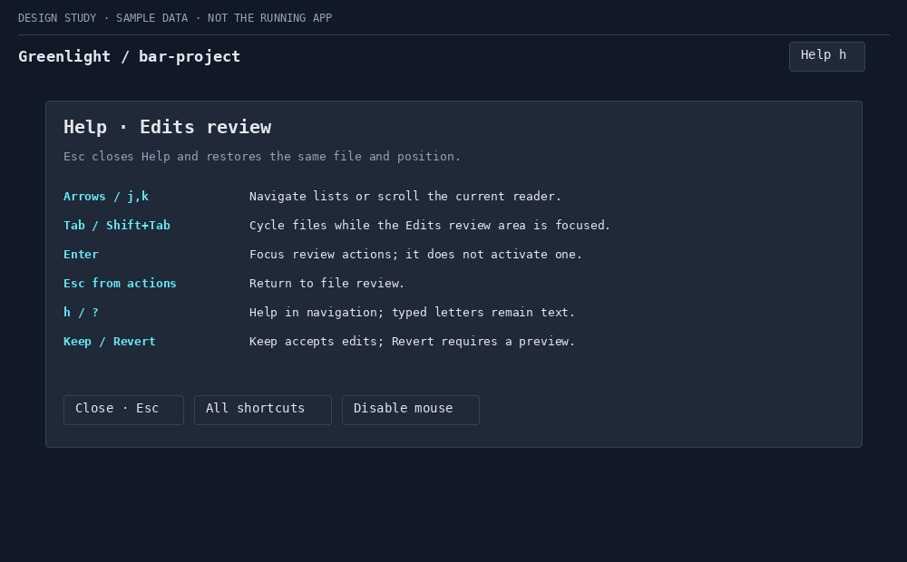
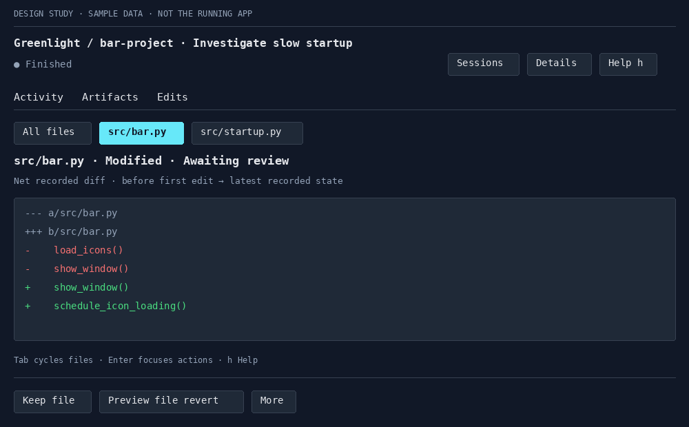

# Compact layout and navigation revision

**Status:** design only. The user approved this denser visual direction in follow-up. Dated 2026-11-17, Europe/Paris. User-selected direction: make the UI more compact; retain arrows, `j/k` and Tab; avoid function-key shortcuts. In follow-up the user explicitly keeps **`h` for Help**, instead of assigning it to move left. Exact spacing and detailed focus transitions below are proposals for implementation review.

This supersedes the F6 proposal in [Edits review](29-edits-and-revert-design.md) and the old [Help study](32-navigation-checkpoints-details-and-help-design.md). Application controls are unchanged.

## 1. Navigation without function keys

| Focus/context | Navigation | Enter | Esc |
| --- | --- | --- | --- |
| Ordinary workspace/navigation | Arrows move/select according to pane; `j/k` aliases down/up; Tab/Shift+Tab cycles eligible focus regions/controls | Open selected item or activate ordinary focused control | Close current reader/layer or return to parent |
| Edits review area | Tab/Shift+Tab cycles All files and file views; up/down or `j/k` selects/scrolls current content | Focus the current view's action controls, without activating one | Return to the parent workspace/list as appropriate |
| Edits action controls | Tab/Shift+Tab or left/right arrows moves between controls | Activate ordinary safe action: Keep or prepare a revert preview | Return focus to the same file-review view |
| Focused editor/search | Arrows move caret; letters, including `h/j/k`, are literal input; Tab follows editor/control focus routing | Explicit editor submit/start contract | Close/leave with draft retained |
| Approval/grant/revert/restart confirmation | Navigate/scroll or focus controls without deciding | Never authorize | Layer-specific deny/cancel contract |
| Help/read-only child layer | Arrows or `j/k` scroll; Tab reaches eligible controls | Ordinary Help controls only | Close Help, restore valid underlying focus |

`h` opens Help in navigation, with `?` retained as an alias and a visible Help action. No `h/l` left/right navigation aliases are introduced. Left/right arrows remain available. Uppercase `H` for activity/history remains a candidate; visible Activity/Recorded activity actions avoid relying on it before the keymap is finalized.

No function key is required to navigate, reach action buttons, close a reader or open Help. Tab does not become global file navigation: it cycles files only while Edits review owns focus. Enter's transfer to Edits actions must be visibly indicated and must not fall through into activation on the same keypress/repeat. Selecting another file does not accept it.

The ordinary `j/k` aliases apply only where lists/readers use vertical navigation. In buttons, text editors and typed modal choices, the focused widget/layer owns interpretation. No shortcut leaks through Help, pasted text, a search field or a pending confirmation.

## 2. Denser Help

[Editable SVG](mockups/help-compact.svg)

Replace widely separated explanation blocks with short key/action rows. Keep the title, a short return instruction and focused controls. All shortcuts remains a separate detailed reference. Explain the current context first. The mouse-capture toggle stays visible and keyboard reachable, including while capture is disabled.

## 3. Denser Edits review

[Editable SVG](mockups/edits-review-compact.svg)

Reduce blank space between header, main tabs, file strip, filename and diff. Keep the user's All files/file cycle and Keep/revert actions. A short local focus hint is acceptable where the special Tab behavior needs explanation; it is not a full permanent global key legend. Only one clear focus region has the active cyan treatment at a time; a selected item in an unfocused region needs a weaker selected style.

## 4. Compactness across the design

- Use one header row where the project/session/state fit, adding a second only for a meaningful overflow. Put full goals/roadmaps/technical metadata in Details.
- Prefer one-line list rows or tightly grouped two-line rows over large empty cards. Keep status words and selected/focused state readable.
- Fit a dialog to its content instead of making every Help/decision modal fill most of the screen. Long content scrolls/expands deliberately.
- Keep related evidence and scope close to action controls. Do not gain density by clipping exact commands, hiding write-grant scope or compressing a reverse diff beyond reviewability.
- Retain readable spacing around destructive actions and distinct status versus model prose. Compact does not mean showing every detail by default.
- Clamp sizes to terminal bounds and grow useful content rather than blank margins on wide screens. At small sizes keep the full-width reader and critical-decision guard.

The revised drawings use 1000×620 illustrative canvases versus the earlier 1200×820 studies. This shows a denser visual direction, not a claim about pixels per terminal cell, a new minimum terminal size or measured usability. Real Ratatui renders still determine row heights, wrapping, button dimensions and accessible contrast.

Earlier PNG/SVG assets remain historical studies. Their function-key text and loose spacing are superseded by this revision; do not implement those older hints. Apply these shared rules when implementing each surface rather than treating every old drawing as an exact pixel specification.

Later checks: every action reachable without function keys; forward/backward Tab cycles; file review ↔ actions; no accidental activation on Enter transfer; arrows and `j/k`; editor literal letters; Help return and expiry; resize; long paths/commands; mouse and keyboard focus equivalence. No model calls or code changes in this design pass.

The [consolidated implementation plan](34-ui-implementation-plan.md) separates agreed direction from detailed proposals and defines the first code slice.

## Edits review implementation — 2026-11-18

Implemented All files and file views, scoped Tab/Shift+Tab cycling, quiet overview row selection, explicit diff opening and separate action focus. Keep file/all persists review intent in `edits.kept` events keyed by session/branch/path/native revision; later writes/restores invalidate the earlier mark and forked branches require their own review. Keep checks fresh snapshots and disk contents under idle-session/native-write guards, records all requested revisions in one event and never mutates source, Git or authorization state. A saved marker describes a recorded revision, not ongoing disk validation; unkept edits are already applied and are not reverted on exit. Keep all refuses conflicts rather than accepting a partial set.

Revert retains the existing restore guards and explicit decision. Reverse diffs use bounded colored readers with prefixes, stale previews expire, Help captures decisions and undersized confirmations cannot activate. Actual [Ratatui captures](screenshots/README.md) cover wide/narrow lists, file diffs, saved review, drift and reverse-diff previews. Verification: 324 full-suite tests passed, one existing test ignored; 125 TUI tests passed after final presentation refinements. Offline build and Clippy completed (five existing test-code warnings). A local fixture-provider PTY check covers Tab cycling, inert focus transfer, Keep one/all and guarded single-file revert without extra inference. Session navigation refinements and the final consistency pass remain separate work.
