# Sandbox reliability and practical verification — research and design

**Design accepted, 2026-11-23. GL-033 lifecycle foundation is implemented on the review branch; GL-027 verification profiles remain proposals.** Current supervision, bounds and recovery behavior are documented in [Linux shell sandbox](10-shell-sandbox.md#process-lifecycle-and-cleanup). Proposed verification controls, statuses and acceptance targets below are not yet supported configuration or tools. No broader execution permission is introduced by the lifecycle work.

## Recommendation

Keep automatic read-only inspection. First make sandbox process ownership and cleanup reliable (GL-033), then provide truthful capability/preflight feedback. For practical project checks (GL-027), prefer an explicitly requested **isolated verification workspace**: run project code against a captured source tree with prepared dependencies and private Git metadata, return check evidence and any formatter diff, and import selected source edits through the existing guarded native journal only after review.

Do not equate a command approval with the filesystem, network, Git, runtime or host-service capabilities required to run it. Do not solve an unsupported sandbox by silently executing on the host. A deliberate host-execution feature would need a separate design and explicit authority; it is not recommended as the default here.

Process groups alone are not a complete descendant-containment guarantee. A normal writable checkout is easier to support but would let formatters, test fixtures and arbitrary hooks bypass the current source-edit journal. That tradeoff needs explicit agreement rather than arriving as a side effect of fixing a stalled process.

## 1. What works now, including “run the pre-commit hook”

The audit covers Greenlight `ad721f0`, not a hypothetical upgraded runner. Native `read` stays project-scoped. The automatic inspection profile uses validated fixed executables and a bounded filtered view. Ordinary approved shell commands use a read-only project bind, masked private paths, private HOME/tmp/cache, cleared environment and no network. See `src/sandbox.rs`, `src/tools.rs`, `src/project_inspection.rs` and `src/paths.rs`.

| User/model request | Available authority today | What can prevent success |
| --- | --- | --- |
| Read `.pre-commit-config.yaml` or `scripts/check.sh` | Ordinary project files are readable, subject to normal read/path policy | File absent, symlink/private path or size restrictions |
| Read/run `.git/hooks/pre-commit` | `.git` is private/masked; a shell grant does not unmask it | Hook is intentionally unavailable through that path |
| Read/run `.githooks/pre-commit` or `scripts/pre-commit` | A normal project script can be read; executing it requires shell authorization unless another explicit policy applies | Missing interpreter/tool, absolute host shebang, hidden Git metadata, read-only project, offline dependencies or unavailable services |
| `pre-commit run --all-files` | Can be requested as an ordinary shell command; it is not an automatically approved inspection command | Binary may be absent; framework needs a Git root; hook environments may require downloads and cache writes; individual hooks may modify files |
| `pre-commit run --files ...` | Same authorization boundary | Explicit filenames do **not** remove the framework's Git-root requirement |
| `pre-commit run` on staged files | Original Git/index state is unavailable | Framework staged-mode behavior can stash unstaged changes; cannot claim equivalent results from a fresh synthetic index |
| `pre-commit install` | Not a read-only check operation | Writes persistent executable hooks in Git metadata; do not combine installation with ordinary check approval |
| `cargo fmt --check` / tests / lint | May work after shell approval if the needed toolchain/dependencies exist | Offline cache completeness, build-script Git queries, runtime paths, fixture writes, timeout and sandbox host support |
| A formatter that rewrites source | Project is read-only in ordinary shell execution | Shell approval, including an explicit user tool rerun, does not grant project writes |
| `systemctl --user`, desktop/session services | Host `/run`, HOME and network are not shared as the normal user session | Host service/socket access is unavailable; ordinary command approval does not provide it |

Readonly mounts do not prevent executing a readable executable script. They prevent writes to the mounted project; scripts still execute code within the sandbox's available authority. Python/Node virtual environments can fail even when their directories exist, because scripts/shebangs or symlinks can refer to host paths absent under `/workspace`.

**Observed in this cloud checkout:** no `.pre-commit-config.yaml`, `.githooks` directory or installed `.git/hooks/pre-commit`; the sample Git hook exists. No `core.hooksPath` value was returned. `pre-commit` was not found on this task host's PATH. These findings say nothing about the user's other projects or machine.

For the framework specifically, upstream `pre_commit/main.py` resolves `git.get_root()`; `commands/run.py` installs hook environments and separately detects changed files. It sets staged-mode stashing only when neither `--all-files` nor `--files` is specified. A failed return therefore cannot automatically be described as “the tests failed,” and the filenames option is not a workaround for masked Git metadata. Sources [P1–P2] below.

## 2. Measured baseline versus benchmark still needed

The checked-in [capability audit](benchmarks/sandbox-capability-audit-2026-11-23.json) records bounded, read-only probes on the cloud task host:

- Bubblewrap is version 0.12.0.
- `unshare --user --map-root-user /usr/bin/true`, guarded by a three-second timeout, exited 1 with `cannot open /proc/self/uid_map: Read-only file system` in approximately 4.65 ms.
- The measured command timings are single process/probe observations, **not** sandbox-startup latency, hook performance or p50/p95 benchmarks.
- No project hook, dependency installation, sandboxed check, paid provider request or source-modification benchmark was executed.

Existing GL-033 evidence documents orphaned pre-namespace helpers holding pipes after startup failure; explicit termination released stalled tests. We did not reproduce that leak again merely to collect a timing. A successful live-isolation/performance result requires a supported Linux host; this host can validate the unsupported-environment path only.

The GL-011 audit measured 443 included files and about 26.6 MB of bodies in this repository at its recorded revision. The inspection profile's shared 8 MiB body budget cannot simply be reused as a whole-project verification-copy limit. Measure a separate verification manifest/copy policy; do not silently omit needed inputs to make a check fit.

### Proposed benchmark matrix

Use trusted synthetic fixtures first, then representative Rust, Python, Node, raw Git-hook and `pre-commit` projects. Run on a namespace-capable Linux host and this restricted host. Pin tool versions, source/hook revisions and cache state. Use at least 30 warm and 5 cold samples where practical; report failures alongside p50/p95, not just successful timings.

| Scenario | Record | Required interpretation / acceptance |
| --- | --- | --- |
| Empty sandbox / namespace denial | Setup elapsed time, phase, exact bounded diagnostic, child/helper inventory | Unsupported setup is blocked, never pass or host fallback; no leftover owned processes |
| Small read-only command and finite pipeline with `head` | Startup/first-output/total time, all stage statuses, discarded bytes | Current short-read and failure-propagation behavior preserved |
| Warm check on prepared dependencies | Snapshot files/bytes, preparation time, check time, peak RSS/cache writes | Results identify the exact snapshot and environment; no model call needed to run the benchmark |
| Cold dependency setup with network denied | Missing package/runtime, attempted domain, phase/time | Blocked environment, not a source-code regression; no silent download or endless retries |
| Explicitly authorized dependency preparation | Downloads, immutable revisions/hashes, domains, cache namespace, cold/warm cost | Distinct approval/setup phase; check execution returns to network-off mode |
| Formatter and failing tests | Exit code, hook output, snapshot diffs, second-run result when requested | Changes-present and checks-pass/fail are separate dimensions; a formatting diff is not proof of pass |
| Full/partial Git state | All-files vs selected files vs staged content, worktrees/submodules/history requirements | Synthetic Git context is labelled; do not claim staged-index equivalence without an actual index design |
| Output flood / blocked pipe | Per-stream/aggregate retained bytes, memory, cancellation/drain time | Hard bounded capture on every execution path; truncation is explicit |
| Startup helper failure, forks and `setsid` descendant | Owned descendant identities before/after stop, parent/helper death, cleanup time | Test descendants outside the original process group, not just direct children |
| TERM-ignoring child, timeout, stop, application shutdown | Stop acknowledgement, escalation, reap/drain completion, leftover resources | UI returns within its cleanup budget; incomplete cleanup is explicit and prevents unsafe continuation |
| External edit while checks run | Input hashes, live/pre-import hashes, applied/rejected patches | No overwrite of manual drift; changed inputs invalidate any claim about the current workspace |
| Secret/network/IPC adversarial fixtures | Benign sentinel access and local controlled connection attempts | No real credentials used; denied project/host paths and sockets stay denied |

Provisional UX goals for discussion: an initial phase/status within 100 ms, stop acknowledgement within 250 ms, and a five-second cleanup reporting budget. These are proposed feedback targets, not measured guarantees that a kernel-stuck process can always die in five seconds. Snapshot preparation, dependency bootstrap and check execution need separate visible timing and cancellation. Approval waiting must not consume an execution timeout while the user reads a dialog. Final limits must follow measurements.

## 3. Risks and mitigations

| Risk / failure | Why it matters | Recommended mitigation |
| --- | --- | --- |
| Hook/test code is arbitrary code, including code just edited by the model | Whitelisting `pre-commit`, `pytest` or a script name does not make its contents safe | Authorize a declared execution profile and target snapshot, not a command prefix; confine all project code regardless of its name |
| Startup/helper descendants survive leader exit | `kill_on_drop`, PID namespaces established later, or a group signal may miss early helpers or `setsid` children | Per-invocation supervision before Bubblewrap starts; evaluate delegated cgroup v2 for descendant containment; reap owned children without stealing unrelated app children |
| Cleanup itself hangs | A timeout around the main execution does not bound later pipe draining; Tokio blocking-file reads cannot simply be aborted like nonblocking I/O | Nonblocking owned pipe I/O, explicit close/cancellation, phase deadlines and bounded drain/reap reporting; do not release ownership as clean while descendants are unconfirmed |
| PID reuse / killing unrelated jobs | A saved PID or process-name match is not a durable authority token | Use stable owned process/cgroup identities and pidfds where appropriate; never global `pkill bwrap` or app-wide `waitpid(-1)` as a cleanup strategy |
| Live formatter/test writes bypass the native journal | Existing diffs/revert/review become incomplete, and manual changes can be overwritten | Prefer writable disposable source copy; return diffs and import reviewed allowed source edits through guarded native writes with hash rechecks |
| Git metadata is executable/sensitive state | Hooks, config, credential-bearing remotes, worktree links and object alternates can change access or behavior | Private fresh Git context for supported snapshot checks; original `.git`, Git config and hooks stay protected; exact original-index/history access needs a trusted broker design (GL-020) |
| Network during checks permits exfiltration or dynamic dependency execution | Domain allowlists do not inspect uploaded contents; a public hosting domain can include attacker-controlled repositories | Network off by default; separately authorize pinned dependency bootstrap, avoid credentials, enforce destinations and retain provenance; do not expose host network or Docker/user-service sockets |
| Shared writable cache poisoning | A later run or host helper could execute model-modified cached programs | Tooling/supervisor outside model-writable paths; verified dependency artifacts, per-project namespaces and job-local writable layers; never execute writable-cache helpers on the host |
| “Private filenames” mistaken for a secret scanner | Tokens can live in arbitrary source/config files or runtime mounts | Preserve current private-path exclusions, narrow runtime mounts and explicit input manifests; avoid universal “secret-free” claims; broker exceptional credentials separately |
| Unbounded stdout/cache/temp/process creation | Current ordinary approved shell capture collects output before presentation truncation; namespaces alone do not impose memory/disk/CPU quotas | Extend bounded capture to ordinary execution; evaluate memory/PID/disk/CPU limits under GL-023, and account for writable tmp/cache as resources |
| False verification success | Exit 1 may mean edits; unavailable services may prevent any check; tests may use a different snapshot | Report raw status plus actual capabilities, inputs, modifications, truncation and cleanup; do not silently skip failing/unavailable checks or treat copying a fix as revalidation |

Strong tree containment and deadline-bounded UI feedback are distinct. Process groups are useful but descendants can leave them. PID namespaces help after setup; they do not by themselves cover a pre-namespace helper failure. A cgroup backend needs host delegation and protection against commands moving themselves out. A dedicated subreaper supervisor is another component to evaluate, but must not turn the whole app into a global orphan reaper. If required containment cannot be established, report that profile as unavailable rather than quietly weaken it.

A kernel-uninterruptible task may outlive the reporting deadline. The result must then be **cleanup incomplete**, with safe operation/resource ownership retained or quarantined and continuation blocked until resolved. Do not report “stopped,” garbage-collect an in-use workspace, import a partial result or launch a replacement merely because a timer fired. Restart identity/recovery needs coordination with GL-019.

## 4. Proposed execution profiles and workflow

These are conceptual capabilities, not new YAML fields accepted today.

| Profile | Source/Git access | Writes and network | Role |
| --- | --- | --- | --- |
| Existing inspection | Filtered project files; no original Git metadata | Private scratch; no network | Browsing and bounded read-only commands |
| Existing approved project shell | Current read-only project and runtime mounts; masked private paths | Private cache/tmp; no network | Commands that actually fit those restrictions |
| Proposed verification workspace | Captured permitted source tree and declared synthetic/private Git context | Writable disposable copy and job cache; network off | Tests, lint and formatter/pre-commit checks |
| Proposed dependency preparation | Locked, declared runtime/hook/dependency recipe | Narrow authorized fetches into isolated/verified cache | Reproducible setup, separate from arbitrary check execution |
| Original Git index/history or host services | Not obtained by a normal shell grant | Not enabled by these profiles | Separate broker/design or manual user action |

```mermaid
flowchart LR
  U[User requests check] --> P[Host capability and recipe preflight]
  P --> A[Existing permission UI plus declared profile]
  A --> S[Capture source and prepare environment]
  S --> R[Confined process tree and bounded output]
  R --> O[Check outcome and proposed edits]
  O --> V[User reviews edits]
  V --> J[Guarded native journal import]
  J --> C[Recheck against current inputs]
```

The default check target should be explicit: current permitted working-tree snapshot / all files, with the file manifest visible in Details. A private fresh Git repository can support some such checks without exposing the original Git database. It is **not** a drop-in replacement for staged-only hooks, Git history/versioning, LFS, submodules, custom templates or worktree semantics. Those cases should be identified as unsupported until individually designed and benchmarked.

Capture must include the actual required allowed inputs, with clear exclusions and byte/file limits. Dependencies/toolchains need declared provisioning rather than blindly copying host virtualenvs with broken absolute paths. Do not mount original `node_modules`, tool caches or a dependency environment writable merely to make a check work. Checks requiring `.env`/service secrets need fixtures, a separate explicit integration policy or manual user evidence.

Keep named check recipes in host-owned settings protected from model file tools. Approval should describe the command/profile, target and authority. A recipe or authority expansion must not inherit an old grant silently. Ordinary edits to tested project code should not trigger a prompt for every file: the user is authorizing arbitrary project-code execution **inside** the stated boundary, not certifying that each script is harmless. User rerun intent skips the existing permission prompt, but does not itself change sandbox capabilities.

## 5. User and model experience

### User feedback

- Before execution, show the named check, target snapshot, Git mode, writes, network policy and dependency readiness. Only offer actions that are available on this host.
- Missing Git/runtime/dependencies: say **Unavailable in this environment**, show the exact reason, and offer Prepare environment / Run manually / Details as applicable. Avoid repeated generic Allow dialogs that cannot fix the missing capability.
- Preparation/running/stopping/cleaning: use the existing output area and contextual controls with elapsed phase, streaming output and `k` stop behavior. Preserve arrow/Tab/mouse access; introduce no function-key dependency.
- A pending approval keeps the runner waiting; Esc hides it without deciding, as today. No implicit host fallback or escalation from a dismissed popup.
- After a formatter, offer **Review generated edits**. The edits are in the check copy until imported. After a failed test, show failed evidence. These can both be true for the same run.
- After cancellation, report retained source edits and whether cleanup is confirmed. If not confirmed, expose diagnostics/recovery and prevent starting a competing execution.
- Keep raw, bounded diagnostics accessible through Details/export while the default view stays concise. Continue recording permission provenance without flooding the default activity history with approval chatter.

### Model-facing contract

Inject a short host-generated capability summary for the active profile: project path, writable locations, Git mode, runtime readiness, network/host-service availability and supported next actions. Do not make the model discover each limitation through repeated failed commands, and do not let model-written prose grant capabilities.

A proposed structured result should distinguish at least:

- Whether process launch is known to have happened, or is unknown.
- Setup/execution phase and reason code; actual exit code/signal when available.
- Check outcome: passed, failed, not run, unknown or cancelled.
- Modifications: none, present or unknown, with exact snapshot/diff references.
- Output truncation and cleanup: confirmed or incomplete.

These are separate dimensions, not an inference that all nonzero exits mean a coding error or all formatter changes mean pass. A CLI can start and partially act before returning an environment error; only a preflight refusal can confidently say nothing launched. Preserve the raw diagnostic when higher-level parsing is uncertain.

For example: “Git metadata unavailable under project-shell; this check was not started by the runner. Use the configured verification workspace or ask the user to run it.” If the command actually launched, report that instead. In both cases, the model should not claim the source failed verification or try unapproved bypasses.

Reuse existing user-directed rerun/history controls; do not add blind retries for arbitrary hook failures. A bounded formatter recheck in the same copy may be offered explicitly, but do not copy Aider's documented two-pass shell wrapper as a general “retry every failure” policy. Imported formatter edits require fresh validation or an explicit current-input match before claiming they are checked. A check against a modified copy is not automatically a check against the user's unchanged checkout.

For host-only services, the safe current route is to request specific manual commands/logs and wait for user input through supported workflow interaction. An existing user tool rerun still runs in the current sandbox; it is not a host-execution feature. A dedicated needs-user-action result/pause is a proposed improvement, not a tool claimed available by this draft.

## 6. Lessons from other projects

All descriptions below refer to the fetched upstream sources pinned in the source list, not a blanket guarantee about every shipped version/deployment. Some documentation websites and GitHub API requests returned proxy 403 here; primary source files were retrieved successfully from the projects' official repositories. We did not benchmark these products against Greenlight.

| Project / source evidence | Useful idea | Boundary we should preserve |
| --- | --- | --- |
| Codex Linux sandbox and execpolicy [C1–C2] | Explicit filesystem/network policy, protected Git/config state, executable identity, positive/negative policy examples and documented platform failures | Its inherited-PID documentation explicitly notes descendants can leave a process group. Do not copy a broad host-read mount or assume a prefix rule is the whole isolation policy |
| Anthropic Sandbox Runtime [S1] | Separate read/write/network rules, private mediation for network, dangerous-config/hook write protection, typed unsupported-profile errors and documented limitations | Its library documents broad default read access; Greenlight's native read remains project-only. Domain allowlists are not data-loss prevention; protect the runtime itself from writable project/cache code |
| OpenHands SDK [O1] | Explicit local versus ephemeral Agent Server workspaces, including Docker/Kubernetes: choose the execution environment as a product capability | OpenHands can also run locally; “uses OpenHands” does not imply Docker isolation. A container must not inherit sensitive mounts, privileged mode or the host Docker socket by default |
| Aider lint/test integration [A1] | Named configurable checks, run selected-file lint commands, feed actionable output back to the model | Its pre-commit formatter example acknowledges file modification and reruns. That is workflow inspiration, not an OS-security guarantee or justification for hiding failures |
| pre-commit [P1–P2] | Treat Git, hook environments and mutations as real requirements; distinguish staged/all-files behavior and exit status from modifications | Running a framework command is arbitrary hook execution. `--files` still needs Git; installing hooks is a different persistent action |
| Bubblewrap [B1] | Compose explicit mount/namespace policy and test the resulting boundary | Upstream says policy is the caller's responsibility. Having the binary installed does not prove isolation works, that descendants are contained during startup, or that resource quotas exist |

## 7. Recommended implementation order and design gates

1. **GL-033: common subprocess lifecycle.** Cover single approved commands, inspection and pipelines, including startup failures and cancellation. Establish explicit supported containment backends, nonblocking/bounded capture and cleanup, phase diagnostics and cleanup-incomplete ownership behavior. Validate direct child, helper, fork and session-escaping cases on supported and restricted hosts. Do not start by broadening filesystem/network permissions.
2. **GL-027 first slice: capability/preflight and truthful feedback.** Surface unavailable Git/runtime/cache/service requirements to the user and model. Preserve exact raw diagnostics and distinguish blocked environment from failed verification. This alone should eliminate much blind trial and error.
3. **GL-027 next slice: isolated working-tree verification workspace.** Start with named offline checks and private Git context where semantics are known. Return formatter diffs for guarded native import; no new staging engine or original `.git` exposure.
4. **Explicit dependency preparation and resource enforcement.** Measure cold/warm Rust/Python/Node/pre-commit recipes, pinned cache provenance and opt-in network setup. Coordinate output/process/memory/disk/CPU limits with GL-023 rather than assume namespaces supply them.
5. **Advanced Git/integration semantics only after a concrete case.** Original staged-index/history/worktree requirements belong with GL-020; remote service credentials and host execution need their own authority design. This does not justify GL-018's broad rollback by default.

Before coding, agree on three product choices: disposable verification copy versus live project shell writes; offline checks plus separate dependency preparation versus network during arbitrary checks; and all-files working-tree checks versus exact original staged-index semantics. Recommended defaults are the first option in each pair. The lifecycle backend choice additionally requires proving what the supported deployment hosts can provide; this cloud host cannot prove a working namespace/cgroup implementation.

## Sources and reproducibility

A [source manifest](benchmarks/sandbox-research-sources-2026-11-23.json) records repository revisions. Links below are pinned to those revisions. The capability JSON above preserves exact probe results and scope. Full upstream repositories were not vendored into Greenlight.

- **C1**: [Codex Linux sandbox README](https://github.com/openai/codex/blob/1589e80b28536af91aef8c8c1671d4c3c428e571/codex-rs/linux-sandbox/README.md).
- **C2**: [Codex execpolicy README](https://github.com/openai/codex/blob/1589e80b28536af91aef8c8c1671d4c3c428e571/codex-rs/execpolicy/README.md).
- **S1**: [Anthropic Sandbox Runtime README](https://github.com/anthropic-experimental/sandbox-runtime/blob/0bbebed0aa9a8e628dc4df8bc30293550a1988eb/README.md).
- **O1**: [OpenHands Software Agent SDK README](https://github.com/OpenHands/software-agent-sdk/blob/077f3fad6d31cd852be5c87176e0a93c3b446126/README.md).
- **A1**: [Aider lint/test documentation](https://github.com/Aider-AI/aider/blob/5dc9490bb35f9729ef2c95d00a19ccd30c26339c/aider/website/docs/usage/lint-test.md).
- **P1**: [pre-commit CLI initialization](https://github.com/pre-commit/pre-commit/blob/ba5c4209a6d561b0dff5db24620778d2133d068e/pre_commit/main.py).
- **P2**: [pre-commit run implementation](https://github.com/pre-commit/pre-commit/blob/ba5c4209a6d561b0dff5db24620778d2133d068e/pre_commit/commands/run.py).
- **B1**: [Bubblewrap security and limitations](https://github.com/containers/bubblewrap/blob/1fb0aa26d3eb66254f7742e704add7f82f41a582/README.md).
